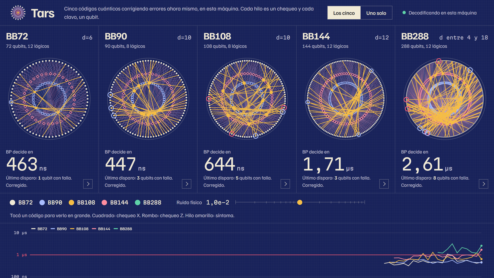
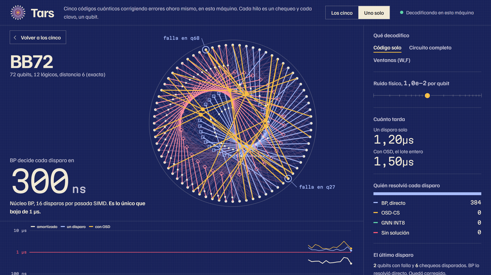
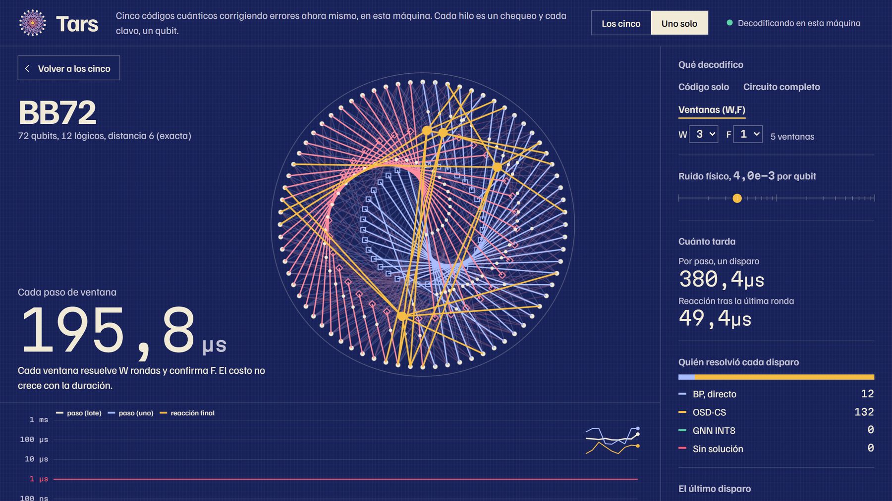
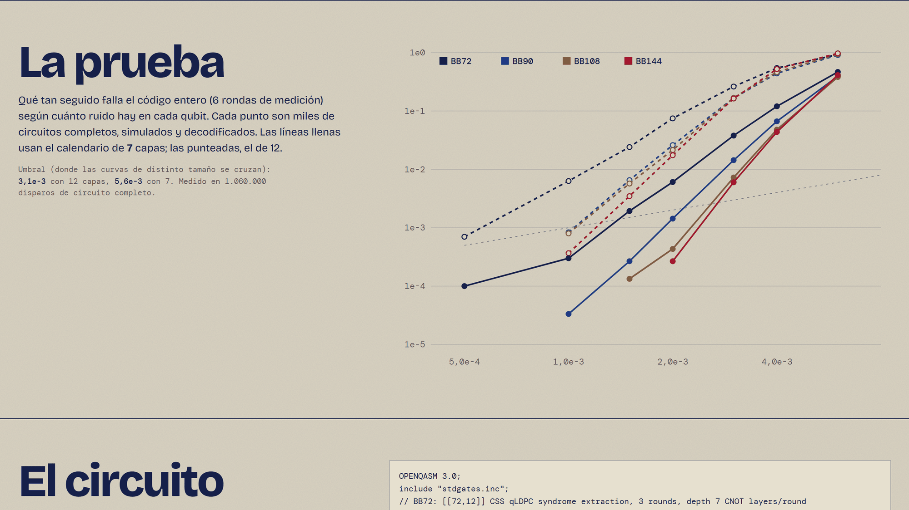
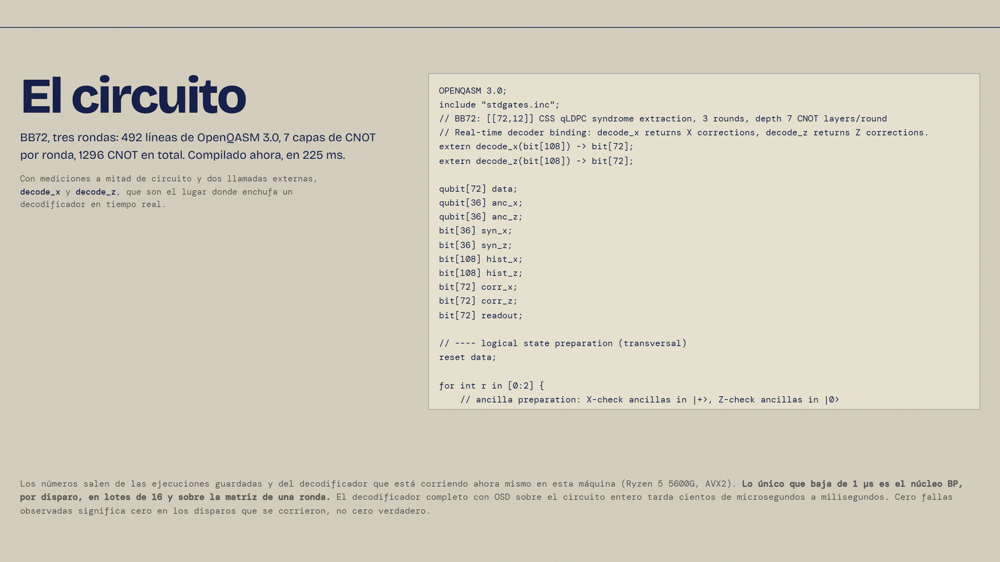

<h1 align="center">FTQC · qLDPC</h1>
<p align="center"><b>Decoder, syndrome-extraction compiler and live console for bivariate-bicycle quantum LDPC codes.</b><br>
Exact code distances, a depth-7 interleaved CNOT schedule, a C++20 AVX2 SIMD BP + OSD decoder, a sliding-window stream decoder, and a one-screen live console.</p>

<p align="center">


</p>

<p align="center"></p>

> **What this is, in one honest paragraph.** A reproducible research codebase: it certifies code distances by MILP, compiles a 7-layer interleaved syndrome-extraction schedule (12 layers if scheduled sequentially), simulates circuit-level memory experiments with Stim, and decodes them with a fixed-point `int16` SIMD min-sum BP kernel plus bit-packed OSD-CS. **Only the BP kernel is sub-microsecond** (0.26-0.62 us per shot, amortized over a 16-shot SIMD pass, per-round matrix); full circuit-level decoding with OSD costs hundreds of microseconds, and a sliding-window decoder lowers the wait after the last round by about 15x (BB72) and 6.6x (BB144) without reaching sub-microsecond. Everything below is measured on one AMD Ryzen 5 5600G; see [Limitations](#honest-limitations).

| | | |
|---|---|---|
| **Codes** | BB72 [[72,12,6]], BB90 [[90,8,10]], BB108 [[108,8,10]], BB144 [[144,12,12]] with exact MILP distances (BB288 bounds only) | `docs/FACTS.md` |
| **Schedule** | 7 CNOT layers per round instead of 12; circuit-level threshold 3.1e-3 -> 5.6e-3 | 1.06 M Monte Carlo shots |
| **BP kernel** | 0.26-0.62 us/shot amortized (16 lanes); 0.6-2.4 us single shot | C++20, `int16`, AVX2 |
| **Sliding window (W,F)** | reaction after last round 79 -> 5 us (BB72), 344 -> 52 us (BB144) at p = 2e-3, (3,1) | accuracy cost on BB144 at higher p |
| **Docs** | [Whitepaper (PDF)](docs/WHITEPAPER.pdf) · [Whitepaper (source)](docs/WHITEPAPER.md) · [Measured facts](docs/FACTS.md) · [API contract](docs/API_CONTRACT.md) | |

## The live console

One screen, no tabs, no CDN: a string-art Tanner graph (each nail is a qubit, each thread a check), live latency readouts, a strip-chart latency record, a schedule scrubber and, below, the measured threshold curves and the compiled OpenQASM 3.0. Switch the live decoder between **code only**, **full-horizon circuit** and **sliding window (W,F)**.

| Schedule explorer | Sliding-window mode (live) |
|---|---|
|  |  |
| **Benchmarks (threshold curves)** | **OpenQASM 3.0 with real-time feedback** |
|  |  |

## Quickstart

```powershell
git clone <this repo> ; cd ftqc-qldpc
scripts\setup.ps1                  # venv (Python 3.12+), dependencies, builds the C++20 decoder, runs the tests
scripts\launch_dashboard.ps1       # API + live console at http://localhost:8000   (/docs for the OpenAPI UI)
$env:PYTHONPATH="src"; .\.venv\Scripts\python.exe -m pytest -q          # 62 tests
.\.venv\Scripts\python.exe scripts\bench_window.py                    # sliding-window study
.\.venv\Scripts\python.exe scripts\build_pdf.py                       # docs/WHITEPAPER.pdf (needs Node and Chrome/Edge)
```

The C++ kernel is compiled with `zig c++` (`pip install ziglang`) or `clang++`; no Rust toolchain is needed. `docs/assets/` is produced by `node scripts/capture_assets.mjs`.

## Architecture

```mermaid
flowchart LR
  A[algebra<br/>BB / lifted product<br/>MILP distance] --> C[circuits<br/>interleaved schedule<br/>Stim + OpenQASM 3.0]
  C --> D[Stim detector error model]
  D --> W[window.py<br/>sliding window (W,F)]
  D --> K
  W --> K[qdecoder.cpp<br/>int16 AVX2 min-sum BP + OSD-CS]
  K --> G[GNN INT8 fallback]
  K --> S[FastAPI + WebSocket]
  G --> S
  S --> U[live console ui/]
  B[benchmarks<br/>Monte Carlo, Parquet/HDF5] --> S
  B --> P[figures + WHITEPAPER.pdf]
```

## Honest limitations

* Sub-microsecond latency is the BP kernel only (amortized, per-round matrix). Full circuit-level BP + OSD is hundreds of microseconds to milliseconds.
* The sliding-window decoder is orchestrated in Python around the C++ kernel and was measured with three configurations on BB72 and BB144; windows much shorter than the code distance lose accuracy (BB144 at p = 3e-3: about 1.9x the full-horizon error rate for W = 3).
* One machine (AVX2, no AVX-512), 6 syndrome rounds, uniform depolarizing noise; BB288 distance is not certified; no hardware-in-the-loop run. The commercial and outreach documents are drafts: pricing and market statements are hypotheses.


## License

Copyright 2026 Francisco. Licensed under the [Apache License, Version 2.0](LICENSE); see also [NOTICE](NOTICE) for the third-party components bundled in `ui/` (Motion, Bricolage Grotesque, DM Mono) and used at build time only (KaTeX, playwright-core).

---

## Technical overview

End-to-end, tested framework: **code algebra → circuit synthesis (Stim, OpenQASM 3.0) → two-tier low-latency decoder (C++20 SIMD BP-OSD + INT8 GNN) → distributed Monte Carlo threshold benchmarks**.

Everything reported below was produced by the code in this repo on one machine (AMD Ryzen 5 5600G, AVX2, Windows 11, Python 3.14, clang via `zig c++`). Numbers are measured, not projected; limitations are stated in [Honest limitations](#honest-limitations).

## Layout

```
src/algebra/     gf2.py (GF(2) linear algebra) · qldpc.py (lifted product, bivariate bicycle, hypergraph product)
                 distance.py (ILP/HiGHS distance with dual bounds) · export.py (.alist, CSR .npz, JSON) · report.py
src/circuits/    schedule.py (König edge-colouring, validation) · interleaved.py (depth-optimised X/Z schedule search)
                 noise.py (depolarizing + T1/T2* idle) · builder.py (Stim memory experiments) · qasm.py (OpenQASM 3.0)
src/decoder/     cpp/qdecoder.cpp (C++20: INT16 SIMD min-sum BP + bit-packed OSD-CS) · fast.py (cffi binding + build)
                 dem.py (DEM → check matrix) · gnn.py (Tanner-graph GNN, INT8 PTQ) · hybrid.py (tiers) · stream.py (asyncio)
src/benchmarks/  montecarlo.py (distributed sampler) · storage.py (Parquet/HDF5) · plotting.py (PDF/SVG) · run.py (CLI)
tests/           pytest suite (algebra, circuits, decoder, QASM, streaming, GNN, storage/plots)
scripts/         setup.ps1 · run_all.ps1
```

## Theory

**CSS qLDPC codes.** A CSS code is a pair of binary parity-check matrices `H_X ∈ F₂^{m_X×n}`, `H_Z ∈ F₂^{m_Z×n}` with the symplectic commutation condition `H_X H_Zᵀ ≡ 0 (mod 2)`, so X- and Z-type stabilizers commute. It encodes `k = n − rank(H_X) − rank(H_Z)` logical qubits; `d_Z = min{|z| : H_X z = 0, z ∉ rowspace(H_Z)}` and symmetrically for `d_X`. The code is *qLDPC* when every row and column of both matrices has bounded weight (here `w_r ≤ 6`, `w_c ≤ 6`; enforced and tested).

**Lifted product (Panteleev–Kalachev).** For protographs `A (m₁×n₁)`, `B (m₂×n₂)` over the ring `R = F₂[x]/(x^ℓ − 1)`,

```
H_X = [ A ⊗ I_{n₂} | I_{m₁} ⊗ B* ],      H_Z = [ I_{n₁} ⊗ B | A* ⊗ I_{m₂} ]
```

(`*` = conjugate transpose). Commutativity of `R` gives `H_X H_Zᵀ = A⊗B* + A⊗B* = 0`. Each ring element is lifted to an `ℓ×ℓ` circulant, giving a sparse binary code. With `1×1` protographs over `F₂[x,y]/(xˡ−1, yᵐ−1)` and `A = x^a+y^b+y^c`, `B = y^d+x^e+x^f`, this is the **bivariate bicycle (BB) family** (Bravyi et al., Nature 627, 2024): `H_X = [A|B]`, `H_Z = [Bᵀ|Aᵀ]`, weight-6 checks, weight-3 columns. Asymmetric choices of `A, B` (different term weights/exponents) make `d_X ≠ d_Z` possible; `hypergraph_product` (Tillich–Zémor) is included as the baseline family.

**Distance.** Minimum logical weight is an integer program: minimize `Σ zᵢ` s.t. `H_X z − 2u = 0`, `L_X z − 2v = y`, `Σ y ≥ 1` (`L_X` = X-logical basis, `y` binary, `u, v` integer slack linearising the mod-2 constraints). HiGHS branch-and-bound returns an incumbent (upper bound, with an explicit logical witness that is re-verified) and a dual bound (lower bound); the distance is *exact* when they meet.

**Circuit-level memory experiment.** Each syndrome round resets ancillas (`RX` for X-checks, `R` for Z-checks), runs CNOT layers (X-checks ancilla→data, Z-checks data→ancilla) and measures (`MX`/`M`) with noise after every operation. Detectors compare consecutive rounds of the checks that are deterministic in the memory basis; observables are the logical operators read out transversally. Edge-colouring the Tanner graph with Δ = 6 colours (König's theorem, alternating-path algorithm) gives a minimum-depth *sequential* schedule (6 X layers + 6 Z layers); an *interleaved* schedule must additionally satisfy the ordering-parity condition (for every X/Z check pair sharing qubits, an even number of shared qubits where the X-CNOT precedes the Z-CNOT), which `commutation_violations` checks and Stim's detector-determinism check re-verifies.

**Noise.** Two-qubit depolarizing after every CNOT, reset flips, measurement flips, and idle noise either depolarizing or a Pauli-twirled T1/T2* channel `p_x = p_y = (1−e^{−t/T₁})/4`, `p_z = (1−e^{−t/T₂})/2 − p_x`.

**Decoding.** The circuit DEM is flattened into `H_dem (detectors × mechanisms)`, an observable matrix and per-mechanism priors (identical symptoms merged by XOR-probability). Tier 0 is normalized min-sum (α = 0.75, INT16 fixed point) with early termination; tier 1 is order-0 + combination-sweep OSD on the BP posterior reliability order, implemented with an incremental bit-packed column basis (cost ≈ `rank · n_cols_used · m/64`); tier 2 feeds posteriors from an INT8 Tanner-graph GNN into the same OSD and keeps the candidate of minimum channel weight.

**OpenQASM 3.0.** `circuits/qasm.py` emits a complete program: mid-circuit `measure`/`reset`, parallel CNOT layers separated by `barrier`, a syndrome-history register, `extern decode_x/decode_z` real-time decoder bindings and `if (corr[i] == 1) { x data[i]; }` dynamic feedback. It is parsed by the reference `openqasm3` parser in the tests.

## Build and run

Requirements: Python >= 3.12 (tested 3.14), `stim`, `numpy`, `scipy`, `networkx`, `pandas`, `pyarrow`, `h5py`, `matplotlib`, `seaborn`, `cffi`, `openqasm3[parser]`, `pytest`; a C++20 compiler (clang/gcc; `pip install ziglang` provides `zig c++`, which `decoder/fast.py` tries first); optional `torch` (GNN training only; INT8 inference is pure numpy). No Rust toolchain was available on the test machine, so the fast tier is C++20 + cffi (PyO3/maturin would be a drop-in alternative: the C ABI is a handful of functions).

```powershell
scripts\setup.ps1                                   # venv, deps, build decoder DLL, run tests
$env:PYTHONPATH="src"
.\.venv\Scripts\python.exe -m pytest -q             # the whole suite
.\.venv\Scripts\python.exe -m algebra.report --out exports --time-limit 300     # [[n,k,d]] table + .alist/.npz/.json
.\.venv\Scripts\python.exe -m benchmarks.run sweep --codes BB72 BB90 BB108 BB144 --rounds 6 --schedule interleaved --out results/run
.\.venv\Scripts\python.exe -m benchmarks.run figures --out results/run          # PDF/SVG in results/run/figures
scripts\run_all.ps1                                 # everything end to end
```

## Results (measured)

### Code parameters (`exports/code_parameters.md`; exact ILP unless stated)

| Code | [[n,k,d]] | d_X / d_Z | exact | w_c / w_r | checks (X+Z) |
|---|---|---|---|---|---|
| BB72  | [[72,12,6]]    | 6 / 6   | yes | 3 / 6 | 72 |
| BB90  | [[90,8,10]]    | 10 / 10 | yes | 3 / 6 | 90 |
| BB108 | [[108,8,10]]   | 10 / 10 | yes | 3 / 6 | 108 |
| BB144 | [[144,12,12]]  | 12 / 12 | yes (280 s) | 3 / 6 | 144 |
| BB288 | [[288,12,<=18]] | 4-18 | bounds only | 3 / 6 | 288 |

`k` and (for the first four) `d` reproduce Bravyi et al. exactly; every ILP witness is re-verified as a nontrivial logical. For BB288 the HiGHS dual bound did not close within the time limit, so 18 is only the published value, **not certified here**.

### Syndrome-extraction depth (CNOT layers per round)

| Schedule | Depth | Notes |
|---|---|---|
| Sequential (Konig colouring, X then Z) | 12 | minimal for a non-interleaved schedule |
| Interleaved (`circuits/interleaved.py`) | **7** | 0 ordering violations; Stim detectors deterministic for BB72/90/108/144 |

Per-round depth including reset and measurement layers: 14 (sequential) vs 9 (interleaved).

### Logical error rate and threshold (circuit-level, 6 rounds, uniform depolarizing p, BP30 + OSD-CS32)

Total P_L over 6 rounds, interleaved schedule (`results/final_int`; adaptive stopping at 80 failures, <= 30 000 shots; `0` = no failure seen within the shot budget, not a true zero):

| p | BB72 | BB90 | BB108 | BB144 |
|---|---|---|---|---|
| 5e-4 | 1.0e-4 | 0 | 0 | 0 |
| 1e-3 | 3.0e-4 | 3.3e-5 | 0 | 0 |
| 1.5e-3 | 1.9e-3 | 2.7e-4 | 1.3e-4 | 0 |
| 2e-3 | 6.1e-3 | 1.4e-3 | 4.3e-4 | 2.7e-4 |
| 3e-3 | 3.8e-2 | 1.4e-2 | 7.3e-3 | 6.0e-3 |
| 4e-3 | 1.2e-1 | 6.7e-2 | 4.8e-2 | 4.4e-2 |
| 6e-3 | 0.47 | 0.40 | 0.38 | 0.41 |

* **Threshold ~ 5.6e-3** (crossing of consecutive-distance curves, `estimate_threshold`), versus ~ 3.1e-3 for the sequential depth-12 schedule (`figures/sequential/`). Pseudo-thresholds (P_L = p): BB72 1.4e-3, BB90 2.1e-3, BB108 2.6e-3, BB144 2.7e-3.
* Below threshold the larger codes win by up to ~ 2 orders of magnitude (p = 2e-3: BB72 6.1e-3 -> BB144 2.7e-4). The threshold depends on this noise model (idle error p on every idle qubit every layer) and on the BP-OSD decoder; it is not a limit of the codes.

Figures (PDF + SVG) in `figures/`: `logical_vs_p`, `logical_total_vs_p`, `threshold`, `latency_batch-amortized`, `latency_single-shot`, `depth_scaling`.

### Decoder latency

| Measurement (AMD Ryzen 5 5600G, AVX2, 16 shots per SIMD pass) | P50 | P95 | P99 |
|---|---|---|---|
| **BP kernel**, code-capacity H_Z (36x72 for BB72, 72x144 for BB144), p = 1e-3..1e-2, amortized per shot over a 16-shot pass | 0.26-0.60 us | 0.27-0.69 us | 0.32-1.2 us |
| BP kernel, same matrices, **one shot at a time** (timer resolution 100 ns) | 0.6-2.4 us | 1.2-4.4 us | 1.3-7.2 us |
| Full circuit-level DEM decode (BP + OSD-CS), interleaved, all p pooled, amortized | 81-540 us | 0.9-3.5 ms | 1.1-4.1 ms |
| Same, one shot at a time | 99-353 us | 2.4-7.6 ms | 3.3-10.5 ms |

The sub-microsecond target is met **only** by the BP kernel on the per-round code-capacity matrix, and only amortized over a 16-shot SIMD pass; single-shot BP is 0.6-2.4 us. Full circuit-level DEM decoding with OSD on BP failures costs hundreds of microseconds to milliseconds (the pooled distributions include p up to 6e-3, where most shots need OSD; at p <= 1e-3 almost all shots stop in BP). Reaching 1 us for the full circuit-level problem needs sliding-window decoding, an FPGA/ASIC BP or AVX-512, none of which is claimed here. `AsyncDecoderService` adds Python/asyncio overhead on top; it exists to make backlog observable (`max_backlog`, end-to-end vs kernel time), not to hit the kernel number.

### GNN tier (INT8)

BB72 H_Z, code-capacity p = 0.06, BP limited to 10 iterations, 2000 shots, GNN with hidden 16, 4 layers, 1500 steps (53 s on CPU): INT8-vs-fp32 sign agreement 99.84 %; logical failure BP+OSD 23.65 % -> BP+OSD+GNN-ordered OSD 22.65 % (24 shots resolved by tier 2). A real but modest gain; larger models, longer training and circuit-level training data were not explored.

## Verification

* 44 pytest tests: GF(2) algebra; `H_X H_Z^T = 0` and weight bounds for all BB codes; rejection of non-commuting inputs; exact ILP distances (BB72 = 6, BB90 = 10) with verified witnesses; `.alist`/CSR/JSON round-trips; Konig colouring optimality and schedule validity; noiseless-circuit determinism (X/Z memory, both detector modes); T1/T2 channel; decoder correctness (every returned correction reproduces its syndrome), zero-syndrome fast path, OSD rescue, streaming/batch agreement; OpenQASM parsed by the reference parser; async service ordering; Monte Carlo reproducibility and monotonicity; Parquet/HDF5 round-trip; GNN training, INT8 and save/load; interleaved-schedule determinism.
* An adversarial audit by Antigravity (`agy`) of the C++ decoder, binding, DEM conversion, sampler and builder reported 11 findings; each was checked against the code. Fixed: OSD-CS silently degrading to OSD-0 once the basis filled (this improved decoding, so all published sweeps were re-run after the fix), int16 saturation / `abs(-32768)` hazard, int16 edge index, 32-bit lane mask, non-thread-safe shared scratch (now locked), schedule-cache race, seed collisions and shot overshoot, all-zero columns for undetectable mechanisms, missing commutation check in the builder. Not changed (judged correct or out of scope): idle noise on data during the first reset and final readout layers (physical), merging mechanisms by detector set only, the per-round conversion formula.

## Honest limitations

* Python 3.14 and clang via zig; no Rust. SIMD is AVX2 (16 x int16); AVX-512 is untested (lane count is the `QD_LANES` compile flag).
* Sub-microsecond latency is **not** achieved for full circuit-level decoding (see table). OSD cost scales with rank x columns x m/64.
* `p_logical_per_round` assumes independent per-round failures and any-observable-flip semantics; it is a convenience scale, not a fitted rate.
* Thresholds come from 6-round memory experiments on four small codes with finite shots; they carry sampling error (Wilson bars in the plots) and depend on the noise model and decoder.
* BB288 distance is not certified by the ILP; GNN gains are modest and measured only at code-capacity level.
* The QASM output is validated by parsing only; no hardware-in-the-loop execution.


## Product layer: API, dashboard, whitepaper, commercial kit

```powershell
scripts\launch_dashboard.ps1            # boots http://localhost:8000 (API + dashboard) and opens the browser
scripts\launch_dashboard.ps1 -Foreground -NoBrowser
```

* `src/api/` - FastAPI + WebSocket server: `GET /api/v1/codes`, `POST /api/v1/compile`, `GET /api/v1/benchmarks` (reads `results/final_int` and `results/final_seq`), `WS /api/v1/stream/decode` (live Stim sampling -> C++ SIMD BP / OSD-CS / INT8 GNN fallback -> telemetry). Contract: `docs/API_CONTRACT.md`; interactive docs at `/docs`.
* `ui/` - the live console, **Telar** (vanilla JS + canvas, no CDN, one screen with a scroll below): string-art Tanner graph, live latency readouts, strip-chart record, schedule scrubber, a decoding-mode switch (code only / full-horizon circuit / sliding window), measured threshold curves and the compiled OpenQASM 3.0.
* `docs/WHITEPAPER.md` and `docs/COMMERCIAL_PITCH.md` are drafted from `docs/FACTS.md`, which `scripts/make_facts.py` regenerates from the stored results; pricing, market and traction statements in the pitch are labelled hypotheses. `scripts/precompute_assets.py` builds the interleaved schedules (including BB288, depth 7) and the small INT8 GNN models used by the live stream.
* Live-stream latency caveat: the HUD shows three separate numbers (amortized BP kernel, single-shot BP kernel, total BP+OSD/GNN) because only the first is reliably below 1 us.

