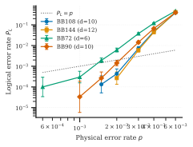
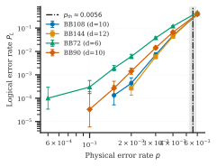

# Sub-Microsecond SIMD Decoding and Depth-7 Interleaved Syndrome Extraction for Bivariate Bicycle qLDPC Codes

**Authors:** Francisco. Code and data: https://github.com/franciscohenderson/ftqc-qldpc

## Abstract

Bivariate bicycle (BB) quantum low-density parity-check (qLDPC) codes offer high encoding rates and circuit-level thresholds, but their practical deployment requires low-depth syndrome extraction schedules and fast decoders. We present an open, end-to-end software framework covering exact code distance certification via mixed-integer linear programming (MILP), depth-7 interleaved CNOT schedule synthesis, OpenQASM 3.0 compilation, and a two-tier decoder combining a C++20 `int16` single-instruction multiple-data (SIMD) normalized min-sum belief propagation (BP) kernel with bit-packed combination-sweep ordered statistics decoding (OSD-CS) and an `int8` quantized graph neural network (GNN) fallback. Crucially, we distinguish kernel-level from circuit-level latency: on an consumer desktop CPU (AVX2), sub-microsecond latency ($268\text{--}618\text{ ns}$ median per shot) is achieved strictly by the `int16` BP kernel amortized across a 16-shot SIMD pass on single-round code-capacity check matrices ($BB72$ and $BB144$), whereas isolated single-shot BP requires $0.6\text{--}2.4\ \mu\text{s}$ and full 6-round circuit-level Detector Error Model (DEM) decoding (BP+OSD-CS) requires $80.6\text{--}539.9\ \mu\text{s}$ median amortized ($99.2\text{--}352.5\ \mu\text{s}$ single-shot, with millisecond tail latencies). Across 6-round circuit-level memory experiments, compressing syndrome extraction from sequential depth 12 to interleaved depth 7 raises the threshold under uniform depolarizing noise from $3.1251 \times 10^{-3}$ to $5.5731 \times 10^{-3}$. A sliding-window $(W, F)$ circuit-level decoder cuts the latency that remains after the last syndrome round from 79 to 5 $\mu$s (P50, BB72, $p = 2 \times 10^{-3}$, $(W,F) = (3,1)$) and from 344 to 52 $\mu$s on BB144, with a logical error rate that is statistically indistinguishable from full-horizon decoding (overlapping 95 % intervals) for $(4,2)$ on BB72 at $p = 2 \times 10^{-3}$ but a measured penalty on BB144 at higher noise; the cost of one window step stays in the tens to hundreds of microseconds, so circuit-level decoding is still not sub-microsecond.

---

## 1. Introduction

Fault-tolerant quantum computing (FTQC) based on planar surface codes incurs high physical-to-logical qubit overhead due to a vanishing asymptotic encoding rate and $O(\sqrt{n})$ distance scaling. Quantum low-density parity-check (qLDPC) codes—constructed via hypergraph products [1], lifted products [2], and bivariate bicycle (BB) group-algebra lifts [3]—achieve constant or high finite-length encoding rates with check weight $w_r \le 6$ and qubit degree $w_c \le 3$. In particular, the BB code family introduced by Bravyi et al. [3] encodes $k \in \{8, 12\}$ logical qubits into $n \in \{72, 90, 108, 144, 288\}$ data qubits over a two-dimensional torus $\mathbb{Z}_\ell \times \mathbb{Z}_m$, matching the native long-range connectivity of neutral-atom arrays and multi-layer superconducting architectures.

Realizing the theoretical overhead reduction of BB codes in practice requires addressing two tightly coupled engineering problems:
1. **Low-depth, commutation-preserving syndrome extraction:** Because $X$-type and $Z$-type checks share data qubits, naively scheduling all $X$-check CNOTs before all $Z$-check CNOTs via bipartite edge-coloring requires $\Delta_X + \Delta_Z = 12$ entangling layers per syndrome round. Any idle layer exposes all non-participating qubits to decoherence. Interleaving $X$- and $Z$-check CNOTs within the same layers reduces circuit depth, provided that the ordering of entangling gates on shared data qubits preserves stabilizer commutativity without introducing hook-like ancilla couplings.
2. **Low-latency iterative and post-processed decoding:** Message-passing belief propagation (BP) over the Tanner graph of a qLDPC code suffers from degenerate quantum errors and short cycles, necessitating post-processing via Ordered Statistics Decoding (OSD) [4]. While OSD substantially improves logical error rates, its Gaussian elimination step introduces variable tail latency when BP fails to converge.

In this work, we describe and benchmark a self-contained software stack implemented in Python 3.14 and C++20 that integrates code construction, MILP distance verification via HiGHS [5], depth-7 interleaved schedule synthesis, circuit-level simulation via Stim [6], OpenQASM 3.0 dynamic feedback generation [7], and a SIMD-accelerated BP+OSD-CS decoder with an optional post-training quantized (`int8`) Tanner-graph GNN tier.

### Scope of the "Sub-Microsecond" Latency Claim

To avoid ambiguity common in decoder benchmarking, we state the exact scope of our latency measurements up front:
* **Sub-microsecond ($268\text{--}618\text{ ns}$ P50) applies exclusively to the `int16` normalized min-sum BP kernel per shot when amortized across a 16-shot AVX2 SIMD pass on a single-round (code-capacity) parity-check matrix** ($H_Z$ of size $36 \times 72$ for BB72 and $72 \times 144$ for BB144, across error rates $p \in \{10^{-3}, 3 \times 10^{-3}, 10^{-2}\}$).
* **Isolated single-shot code-capacity BP** (executing a single syndrome in SIMD lane 0 without batch amortization) requires **$600\text{--}2400\text{ ns}$ ($0.6\text{--}2.4\ \mu\text{s}$) P50** and $1.3\text{--}6.1\ \mu\text{s}$ P99.
* **Full circuit-level decoding**—operating on the flattened 6-round Detector Error Model (DEM) with bit-packed OSD-CS invoked whenever BP does not converge—requires **$80.6\text{--}539.9\ \mu\text{s}$ P50** in batch-amortized mode and **$99.2\text{--}352.5\ \mu\text{s}$ P50** in single-shot mode for the depth-7 interleaved schedule (with P95 latencies of $0.87\text{--}3.50\text{ ms}$ batch-amortized and $2.43\text{--}7.61\text{ ms}$ single-shot, pooled across $p \in [5 \times 10^{-4}, 6 \times 10^{-3}]$).

---

## 2. Background

### 2.1 CSS Quantum LDPC Codes

A Calderbank–Shor–Steane (CSS) quantum stabilizer code of length $n$ is defined by a pair of binary parity-check matrices $H_X \in \mathbb{F}_2^{m_X \times n}$ and $H_Z \in \mathbb{F}_2^{m_Z \times n}$ satisfying the symplectic orthogonality condition:

$$H_X H_Z^T \equiv 0 \pmod 2.$$

This condition guarantees that every $X$-type stabilizer generator (a row of $H_X$) shares an even number of data qubits with every $Z$-type stabilizer generator (a row of $H_Z$), so all generators commute. The code encodes

$$k = n - \mathrm{rank}_{\mathbb{F}_2}(H_X) - \mathrm{rank}_{\mathbb{F}_2}(H_Z)$$

logical qubits. A $Z$-type logical operator corresponds to a binary vector $z \in \ker(H_X) \setminus \mathrm{rowspace}(H_Z)$, and the $Z$-distance is the minimum Hamming weight of such an operator:

$$d_Z = \min \{ |z| : H_X z \equiv 0 \pmod 2,\ z \notin \mathrm{rowspace}(H_Z) \},$$

with $d_X$ defined symmetrically by swapping $H_X$ and $H_Z$. The overall code distance is $d = \min(d_X, d_Z)$. A family of CSS codes is *low-density* (qLDPC) if the maximum column weight $w_c = \max(\|H_X\|_{1,\text{col}}, \|H_Z\|_{1,\text{col}})$ and maximum row weight $w_r = \max(\|H_X\|_{1,\text{row}}, \|H_Z\|_{1,\text{row}})$ are bounded by a small constant independent of $n$ (in our constructions, $w_c \le 6$ and $w_r \le 6$).

### 2.2 Lifted Product and Bivariate Bicycle (BB) Codes

In the Panteleev–Kalachev lifted product construction [2], let $R = \mathbb{F}_2[x]/(x^\ell - 1)$ be the ring of circulant polynomials of lift size $\ell$, and let $A \in R^{m_1 \times n_1}$ and $B \in R^{m_2 \times n_2}$ be protograph matrices over $R$. Lifting each ring entry to its $\ell \times \ell$ binary circulant matrix and denoting the conjugate transpose (binary transpose of the lift) by $*$, the parity-check matrices are:

$$H_X = \left[\, A \otimes I_{n_2} \;\middle|\; I_{m_1} \otimes B^* \,\right], \qquad H_Z = \left[\, I_{n_1} \otimes B \;\middle|\; A^* \otimes I_{m_2} \,\right].$$

Because $R$ is commutative when $m_1 = n_1 = m_2 = n_2 = 1$, $H_X H_Z^T = A B^* + A B^* \equiv 0 \pmod 2$ holds automatically. Setting $\ell = 1$ with arbitrary binary matrices $H_1, H_2$ recovers the Tillich–Zémor hypergraph product [1].

The **bivariate bicycle (BB)** code family [3] specializes the $1 \times 1$ lifted product to the commutative bivariate group algebra $\mathbb{F}_2[x, y]/(x^\ell - 1, y^m - 1)$ of order $\ell m$, represented by shift matrices $S_x = C_\ell \otimes I_m$ and $S_y = I_\ell \otimes C_m$, where $C_r$ is the $r \times r$ cyclic shift matrix. Choosing three-term polynomials

$$A = A_0 + A_1 + A_2, \qquad B = B_0 + B_1 + B_2,$$

where each $A_i, B_j$ is a monomial of the form $x^a$ or $y^b$, yields binary matrices $A, B \in \mathbb{F}_2^{\ell m \times \ell m}$ of row and column weight 3. The resulting CSS code has length $n = 2\ell m$, $m_X = \ell m$ $X$-checks, $m_Z = \ell m$ $Z$-checks, parity-check matrices

$$H_X = [\; A \mid B \;], \qquad H_Z = [\; B^T \mid A^T \;],$$

uniform column weight $w_c = 3$, and uniform check weight $w_r = 6$.

### 2.3 Circuit-Level Memory Experiments and Dynamic Feedback

In a circuit-level memory experiment in basis $B \in \{Z, X\}$, all $n$ data qubits are initialized in $|0\rangle$ (for $B=Z$) or $|+\rangle$ (for $B=X$), followed by $R$ rounds of syndrome extraction and a final transversal readout of the data qubits. In each round, $m_X$ $X$-ancillas are reset to $|+\rangle$ (`RX`) and $m_Z$ $Z$-ancillas to $|0\rangle$ (`R`), a schedule of parallel CNOT layers entangles ancillas with data qubits ($X$-checks: $\text{ancilla} \to \text{data}$; $Z$-checks: $\text{data} \to \text{ancilla}$), and ancillas are measured in their respective bases (`MX` and `M`).

In Stim [6], *detectors* are parity combinations of measurement outcomes that are deterministic in the absence of noise (comparing consecutive rounds of the basis-matched checks, plus comparing the final round against the transversal data readout), while *observables* track the net parity of the $k$ logical operators across the final readout. For hardware integration, OpenQASM 3.0 [7] expresses the same loop with mid-circuit `measure` and `reset` instructions, `barrier`-separated parallel CNOT layers, syndrome history bit registers, `extern` real-time decoder calls (`decode_x`, `decode_z`), and conditional Pauli feedback (`if (corr_x[i] == 1) { x data[i]; }`).

---

## 3. Code Construction and Exact Distance by MILP

Computing the exact minimum distance $d_Z$ (or $d_X$) of a CSS code is NP-hard in general. Following `src/algebra/distance.py`, we formulate the minimum-weight nontrivial logical operator problem as an exact Mixed-Integer Linear Program (MILP) solved via the HiGHS branch-and-bound solver [5] (`scipy.optimize.milp`).

Let $H_X \in \{0,1\}^{m_X \times n}$ be the $X$-check matrix and $L_X \in \{0,1\}^{k \times n}$ be a basis for the $X$-type logical operators (computed in `src/algebra/qldpc.py` as the rowspace complement of $H_X$ inside $\ker(H_Z)$ over $\mathbb{F}_2$). A binary vector $z \in \{0,1\}^n$ is a valid, nontrivial $Z$-type logical operator if and only if $H_X z \equiv 0 \pmod 2$ (it commutes with all $X$-checks) and $L_X z \not\equiv 0 \pmod 2$ (it anticommutes with at least one $X$-logical operator, hence $z \notin \mathrm{rowspace}(H_Z)$). We linearize the modulo-2 constraints by introducing integer slack variables $u \in \mathbb{Z}_{\ge 0}^{m_X}$, $v \in \mathbb{Z}_{\ge 0}^k$, and binary anticommutation indicators $y \in \{0,1\}^k$:

$$\begin{aligned}
\min_{z, u, v, y} \quad & \sum_{i=1}^{n} z_i \\
\text{subject to} \quad & H_X z - 2u = 0, \\
& L_X z - 2v - y = 0, \\
& \sum_{j=1}^{k} y_j \ge 1, \\
& z \in \{0,1\}^n, \quad y \in \{0,1\}^k, \quad u \in \mathbb{Z}_{\ge 0}^{m_X}, \quad v \in \mathbb{Z}_{\ge 0}^{k}.
\end{aligned}$$

In `src/algebra/distance.py`, the decision vector of length $N_{\text{var}} = n + m_X + 2k$ stacks $(z, u, v, y)$ with explicit finite upper bounds $u_i \le \lfloor \max_r \sum_c (H_X)_{r,c} / 2 \rfloor$ and $v_j \le \lfloor \max_r \sum_c (L_X)_{r,c} / 2 \rfloor + n$. The symmetric program with $(H_Z, L_Z)$ determines $d_X$.

HiGHS is invoked with `mip_rel_gap = 0.0` and `presolve = True`. Upon termination or timeout, HiGHS returns both an incumbent integer solution $z^*$ of weight $d_{\text{upper}} = \sum_i z^*_i$ and a linear-programming relaxation dual bound, from which we extract the certified integer lower bound:

$$d_{\text{lower}} = \max\!\left(1,\, \min\!\left(d_{\text{upper}},\, \left\lceil \text{mip\_dual\_bound} - 10^{-6} \right\rceil\right)\right).$$

The distance is certified **exact** if and only if $d_{\text{lower}} = d_{\text{upper}}$ for both $d_X$ and $d_Z$. Every returned incumbent witness $z^*$ is independently verified in `verify_logical` by checking $((H_X z^*) \bmod 2 == 0) \land ((L_X z^*) \bmod 2 \ne 0)$.

### Table 1: Bivariate Bicycle Code Parameters and MILP Certification (`docs/FACTS.md`)

| Code | $(\ell, m)$ | Polynomial $A$ | Polynomial $B$ | $[[n, k, d]]$ | $d_X$ | $d_Z$ | Exact | $w_c / w_r$ | Checks ($X+Z$) | ILP Time (s) |
|---|---|---|---|---|---|---|---|---|---|---|
| **BB72** | $(6, 6)$ | $x^3 + y + y^2$ | $y^3 + x + x^2$ | $[[72, 12, 6]]$ | $6$ | $6$ | yes | $3 / 6$ | $72$ | $0.8\text{ s}$ |
| **BB90** | $(15, 3)$ | $x^9 + y + y^2$ | $1 + x^2 + x^7$ | $[[90, 8, 10]]$ | $10$ | $10$ | yes | $3 / 6$ | $90$ | $37.1\text{ s}$ |
| **BB108** | $(9, 6)$ | $x^3 + y + y^2$ | $y^3 + x + x^2$ | $[[108, 8, 10]]$ | $10$ | $10$ | yes | $3 / 6$ | $108$ | $57.3\text{ s}$ |
| **BB144** | $(12, 6)$ | $x^3 + y + y^2$ | $y^3 + x + x^2$ | $[[144, 12, 12]]$ | $12$ | $12$ | yes | $3 / 6$ | $144$ | $280.3\text{ s}$ |
| **BB288** | $(12, 12)$ | $x^3 + y^2 + y^7$ | $y^3 + x + x^2$ | $[[288, 12, \le 18]]$ | $4\text{--}18$ | $4\text{--}18$ | bounds only | $3 / 6$ | $288$ | $600.6\text{ s}$ |

For BB72, BB90, BB108, and BB144, the HiGHS dual bound closes to the incumbent, certifying the exact distances $d \in \{6, 10, 10, 12\}$. For BB288, the solver reached the $600.6\text{ s}$ timeout (300 s per basis) with an incumbent of weight 18 and a dual lower bound of 4; thus $d \le 18$ is reported strictly as a bound rather than a certified exact distance.

---

## 4. Depth-7 Interleaved Syndrome Extraction

### 4.1 Sequential Baseline via König Bipartite Edge-Coloring

In `src/circuits/schedule.py`, a syndrome extraction schedule is represented as a list of parallel CNOT layers, where each layer is a set of triples $(\text{kind}, c, q) \in \{X, Z\} \times \mathbb{Z}_{\ge 0} \times \{0, \dots, n-1\}$. Within a single layer, no data qubit $q$ and no check ancilla $(\text{kind}, c)$ may appear more than once.

By König's theorem, the bipartite Tanner graph of a binary parity-check matrix $H$ with maximum degree $\Delta = \max(w_c, w_r)$ admits an exact edge-coloring with $\Delta$ colors, where each color class is a conflict-free matching. Our `edge_colour_bipartite(h)` routine constructs this coloring greedily edge-by-edge: if edge $(i, j)$ finds color $a$ free at check $i$ and color $b \ne a$ free at qubit $j$ (with $a$ occupied at $j$), it traces the unique maximal $(a, b)$-alternating path starting at qubit $j$ and swaps colors $a \leftrightarrow b$ along the path to make color $a$ free at both endpoints. Applying `edge_colour_bipartite` to $H_X$ ($\Delta_X = 6$) and then to $H_Z$ ($\Delta_Z = 6$) produces `sequential_schedule`, which has optimal non-interleaved depth $\Delta_X + \Delta_Z = 12$ CNOT layers per round.

### 4.2 Symplectic Ordering-Parity Condition for Interleaved Schedules

When $X$-check CNOTs ($\mathrm{CX}(\text{anc}_X[s], \text{data}[q])$) and $Z$-check CNOTs ($\mathrm{CX}(\text{data}[q], \text{anc}_Z[r])$) are interleaved across the same time steps, two CNOTs sharing a data qubit $q$ do not commute: reversing their order conjugates the pair by a cross-ancilla $\mathrm{CX}(\text{anc}_X[s], \text{anc}_Z[r])$ phase kickback. For an $X$-check $s$ and a $Z$-check $r$ sharing the data-qubit set $Q_{s,r} = \{q : (H_X)_{s,q} = 1 \text{ and } (H_Z)_{r,q} = 1\}$, these ancilla-to-ancilla couplings cancel modulo 2 if and only if an **even** number of shared data qubits execute their $X$-CNOT before their $Z$-CNOT [3]:

$$\forall s \in \{0, \dots, m_X - 1\},\ \forall r \in \{0, \dots, m_Z - 1\}: \quad \sum_{q \in Q_{s,r}} \mathbb{I}\!\left[\, t_X(s, q) < t_Z(r, q) \,\right] \equiv 0 \pmod 2,$$

where $t_X(s, q)$ and $t_Z(r, q)$ denote the layer indices assigned to the respective Tanner-graph edges. In `src/circuits/schedule.py`, `commutation_violations(layers, hx, hz)` evaluates this sum over all $(s, r)$ pairs and returns the count of odd-parity pairs, which must be $0$.

### 4.3 Interleaved Schedule Synthesis (`src/circuits/interleaved.py`)

The function `find_interleaved_schedule` synthesizes low-depth schedules satisfying both `validate_schedule` and `commutation_violations == 0` via a two-stage algorithm:

1. **Block Decomposition (`_decompose_bb_blocks`):** Given $(H_X, H_Z)$, the algorithm verifies whether $H_X = [A \mid B]$ and $H_Z = [B^T \mid A^T]$ decompose into sums of commuting $\mathbb{Z}_\ell \times \mathbb{Z}_m$ translation permutation matrices $A = \bigoplus_{i=0}^{w_A-1} A_i$ and $B = \bigoplus_{j=0}^{w_B-1} B_j$ (either from `code.meta` or by automatically factoring $m_X = \ell m$ and testing translation invariance from row 0).
2. **Translation-Invariant Formulation (`bb_translation_schedule`):** Because each $A_i$ and $B_j$ is a bijection on $\{0, \dots, \ell m - 1\}$, assigning a uniform time step to all edges generated by the same monomial term automatically guarantees conflict freedom at every check and data qubit provided the assigned times are distinct where edges share an endpoint. This reduces the entire schedule to $2(w_A + w_B) = 12$ integer time variables in $\{0, \dots, \text{depth}-1\}$:
   * $xl_t[i]$ ($i \in \{0, \dots, w_A-1\}$): $X$-check to left data block ($A_i$),
   * $xr_t[j]$ ($j \in \{0, \dots, w_B-1\}$): $X$-check to right data block ($B_j$),
   * $zl_t[j]$ ($j \in \{0, \dots, w_B-1\}$): $Z$-check to left data block ($B_j^T$),
   * $zr_t[i]$ ($i \in \{0, \dots, w_A-1\}$): $Z$-check to right data block ($A_i^T$).
   Conflict freedom requires four pairwise disjointness conditions on the time sets:
   * $X$-ancilla disjointness: $|xl_t \cup xr_t| = w_A + w_B$,
   * $Z$-ancilla disjointness: $|zl_t \cup zr_t| = w_A + w_B$,
   * Left data-qubit disjointness: $|xl_t \cup zl_t| = w_A + w_B$,
   * Right data-qubit disjointness: $|xr_t \cup zr_t| = w_A + w_B$.
3. **Vectorized Commutation Check and Analytical Depth-7 Staircase:** By translation invariance, $X$-check $0$ and $Z$-check $r$ share a left data qubit via $(A_i, B_j^T)$ if and only if they also share a right data qubit via $(B_j, A_i^T)$ (since $A_i B_j = B_j A_i$). Precomputing the overlap index pairs $(i, j)$ for each $r$ (`ab_overlap`) reduces the commutation check (`_bb_commutation_ok`) to comparing the $w_A \times w_B$ indicator matrices $\text{left\_lt}[i, j] = \mathbb{I}[xl_t[i] < zl_t[j]]$ and $\text{right\_lt}[i, j] = \mathbb{I}[xr_t[j] < zr_t[i]]$. Specifically, if $\text{left\_lt} = \text{right\_lt}$ elementwise, every pair $(i, j)$ contributes one left qubit and one right qubit with identical $X$-before-$Z$ ordering, so their parities cancel identically ($1 \oplus 1 = 0$) for any commuting polynomials $A, B$.
   For $k_{\max} = \max(w_A, w_B) = 3$, `bb_translation_schedule` evaluates the analytical staircase assignment of depth $2 k_{\max} + 1 = 7$ (layers $0, \dots, 6$):

   $$\begin{aligned}
   xl_0 &= [\, 2i \;\text{ for } i \in \{0, 1, 2\} \,] = [0, 2, 4], \\
   zl_0 &= [\, 2j + 1 \;\text{ for } j \in \{0, 1, 2\} \,] = [1, 3, 5], \\
   xr_0 &= [\, 2(k_{\max} - 1 - j) + 1 \;\text{ for } j \in \{0, 1, 2\} \,] = [5, 3, 1], \\
   zr_0 &= [\, 2(k_{\max} - i) \;\text{ for } i \in \{0, 1, 2\} \,] = [6, 4, 2].
   \end{aligned}$$

   Under this assignment, $xl_0 \cup xr_0 = \{0,1,2,3,4,5\}$, $zl_0 \cup zr_0 = \{1,2,3,4,5,6\}$, $xl_0 \cup zl_0 = \{0,1,2,3,4,5\}$, and $xr_0 \cup zr_0 = \{1,2,3,4,5,6\}$ each have cardinality $6$, and for all $i, j \in \{0, 1, 2\}$:

   $$(xl_0[i] < zl_0[j]) \iff (2i < 2j + 1) \iff (i \le j) \iff (6 - 2j - 1 < 6 - 2i) \iff (xr_0[j] < zr_0[i]).$$

   Thus $\text{left\_lt} = \text{right\_lt}$ holds universally, yielding a conflict-free depth-7 schedule with zero commutation violations across the entire BB family. If a tighter depth is requested, `bb_translation_schedule` runs up to `max_tries = 20000` stochastic trials over conflict-free 12-variable assignments.
4. **Kempe-Chain Simulated Annealing Fallback (`_bipartite_kempe_sa`):** For general CSS codes without BB structure, `find_interleaved_schedule` colors the combined bipartite graph $H_{\text{comb}} = [H_X; H_Z]$ in $d$ colors and minimizes `num_bad` (the number of odd-parity check pairs) via simulated annealing (`temp` decaying linearly from $1.5$ to $0.05$). At each step, an edge $(u, q)$ is selected (with $85\%$ bias toward edges participating in violated check pairs) and moved from color $a$ to a random color $b \ne a$ either by an $O(1)$ free-color move or by flipping the maximal $(a, b)$-alternating Kempe component containing $(u, q)$, incrementally updating `parity[s, r]` in $O(w_c)$ time.

### 4.4 Stim Detector Determinism Verification and Depth Comparison

Every synthesized schedule is verified in two independent ways: (1) algebraically via `validate_schedule` and `commutation_violations(layers, hx, hz) == 0`, and (2) at the circuit level by building the noiseless Stim memory circuit (`NoiseModel(0,0,0,0)`) in both $Z$ and $X$ bases and invoking `circuit.detector_error_model(allow_gauge_detectors=False)`, which raises an exception if any detector has non-deterministic parity.

### Table 2: Per-Round Syndrome Extraction Depth and Gate Counts (`docs/FACTS.md`, `src/circuits/builder.py`)

| Code | $n$ | Ancillas ($m_X + m_Z$) | Total Qubits ($n + m_X + m_Z$) | CNOTs / Round ($\|H_X\| + \|H_Z\|$) | Sequential CNOT Depth | Interleaved CNOT Depth | Sequential Total Depth / Round (+Reset/Meas) | Interleaved Total Depth / Round (+Reset/Meas) | Ordering Violations |
|---|---|---|---|---|---|---|---|---|---|
| **BB72** | $72$ | $72$ | $144$ | $432$ | $12$ | $7$ | $14$ | $9$ | $0$ |
| **BB90** | $90$ | $90$ | $180$ | $540^*$ | $12$ | $7$ | $14$ | $9$ | $0$ |
| **BB108** | $108$ | $108$ | $216$ | $648^*$ | $12$ | $7$ | $14$ | $9$ | $0$ |
| **BB144** | $144$ | $144$ | $288$ | $864$ | $12$ | $7$ | $14$ | $9$ | $0$ |
| **BB288** | $288$ | $288$ | $576$ | $1728^*$ | $12$ | $7$ | $14$ | $9$ | $0$ |

*\*Derivation from `docs/FACTS.md`: Every check row in $H_X$ and $H_Z$ has weight $w_r = 6$ and $m_X + m_Z = n$, so $\text{CNOTs per round} = |H_X| + |H_Z| = 6n$ (explicitly listed as $432$ for BB72 and $864$ for BB144 in `docs/FACTS.md`, and $6 \times 90 = 540$, $6 \times 108 = 648$, $6 \times 288 = 1728$ for BB90, BB108, BB288).*

---

![[wide] Figure 1. Circuit depth and CNOT overhead per round, sequential versus interleaved schedule, across the BB codes.](../figures/depth_scaling.svg)

## 5. SIMD Decoder Architecture and Adversarial Audit

### 5.1 Fixed-Point `int16` SIMD Normalized Min-Sum Belief Propagation

The fast decoding tier (`src/decoder/cpp/qdecoder.cpp`, bound via `cffi` in `src/decoder/fast.py`) implements flood-scheduled normalized min-sum belief propagation over the CSR/CSC representation of a binary check matrix $H \in \mathbb{F}_2^{m \times n}$ with per-column error priors $p_j \in (0, 1)$.

To maximize instruction-level throughput on CPU, SIMD vectorization is performed **across independent shots** rather than across graph edges. Using Clang's vector extension `typedef int16_t V __attribute__((ext_vector_type(QD_LANES)))` with `QD_LANES = 16` (fitting one 256-bit AVX2 register), every check-to-variable message $r_e$, variable-to-check message $q_e$, and posterior log-likelihood ratio (LLR) $\text{tot}_j$ is a 16-lane vector holding the corresponding quantity for 16 independent syndromes simultaneously.

1. **Channel Initialization:** Each column prior $p_j$ (clamped to $[10^{-12}, 1 - 10^{-12}]$) is converted to a floating-point log-likelihood ratio $l_j = \ln((1 - p_j)/p_j)$ (`d->w[j]`, used as the OSD cost weight) and quantized to a 16-bit signed integer with scale `llr_scale = 16.0`:

   $$\mathrm{ch}_j = \mathrm{clip}\!\left(\mathrm{round}(16.0 \cdot l_j),\, 1,\, \frac{\mathrm{LLR\_MAX}}{4}\right), \qquad \mathrm{LLR\_MAX} = 8000.$$

   Positive $\text{tot}_j[l] \ge 0$ indicates $e_j = 0$ is more likely, while $\text{tot}_j[l] < 0$ indicates $e_j = 1$ is more likely.
2. **Check-Node Update (Normalized Min-Sum, $\alpha = 0.75$):** For each check $c \in \{0, \dots, m-1\}$ and incident edge $e \in [\text{chk\_ptr}[c], \text{chk\_ptr}[c+1])$, the extrinsic variable-to-check message is formed on the fly by saturating subtraction:

   $$q_e = \mathrm{vsat\_sub}(\mathrm{tot}_{v(e)},\, r_e^{\text{old}}).$$

   In a single pass over the incident edges of check $c$, the kernel computes the running product of signs $\mathrm{sgn} = s_c \oplus \bigoplus_e (q_e \gg 15)$ (where $s_c[l] = -1$ if syndrome bit $c$ in lane $l$ is $1$, else $0$), along with the first minimum magnitude $m_1$, second minimum magnitude $m_2$, and the check-local index $\mathrm{idx} = e - e_0$ achieving $m_1$, using branchless vector selects (`vsel`) and `__builtin_elementwise_abs`. Both minima are scaled by $\alpha = 0.75$ via shift-and-subtract without multiplication:

   $$n_1 = m_1 - (m_1 \gg 2), \qquad n_2 = m_2 - (m_2 \gg 2).$$

   Each outgoing check-to-variable message $r_e$ selects $n_2$ if $e - e_0 == \mathrm{idx}$ and $n_1$ otherwise, applying the extrinsic sign $\mathrm{sign}_e = \mathrm{sgn} \oplus (q_e \gg 15) \in \{0, -1\}$ via two's-complement bit manipulation $r_e = (\mathrm{mag}_e \oplus \mathrm{sign}_e) - \mathrm{sign}_e$.
3. **Variable-Node Update and Clamping:** For each variable $j \in \{0, \dots, n-1\}$, the posterior LLR accumulates the channel LLR and all incoming check messages via saturating addition (`__builtin_elementwise_add_sat`), and clamps the result to $[-\mathrm{LLR\_MAX}, +\mathrm{LLR\_MAX}] = [-8000, +8000]$ to prevent overflow in subsequent iterations.
4. **Per-Lane Early Termination:** A 64-bit mask `active` tracks which of the `nshots <= 16` lanes have not yet converged. Before iteration 1 (the zero-syndrome fast path at `it = 0`) and at the end of every iteration `it`, `syndrome_check()` computes the unsatisfied check mask across all lanes in parallel using the sign bits $\mathrm{tot}_j \gg 15$. Any active lane $l$ whose syndrome is satisfied (`bad[l] == 0`) immediately writes its hard decision $\hat{e}_j = (\mathrm{tot}_j[l] < 0)$, records `iters[l] = it` and `status[l] = 0`, and clears bit $l$ in `active`. If `active == 0`, the entire 16-shot SIMD pass terminates early.

### 5.2 Bit-Packed Combination-Sweep OSD (`OSD-CS`)

Lanes that remain active after `max_iter` iterations invoke scalar bit-packed Ordered Statistics Decoding (`osd` in `qdecoder.cpp`). Columns $j \in \{0, \dots, n-1\}$ are sorted in ascending order of their signed `int16` posterior LLR $\mathrm{post}[j]$ via `std::stable_sort`, placing the most likely error mechanisms (most negative LLRs) first.

Each column of $H$ is stored as a bitset of $W = \lceil m / 64 \rceil$ 64-bit words (`uint64_t`), and combinations of basis columns are tracked in bitsets of $CW = \lceil m / 64 \rceil$ 64-bit words. Scanning columns in reliability order $j = \mathrm{order}[\mathrm{idx}]$:
* The column bitset `vec` is XOR-reduced against the current pivot basis (`reduce(vec, comb)`).
* If `vec` is nonzero, its lowest set bit `piv = k * 64 + __builtin_ctzll(vec[k])` defines a new pivot row, extending the basis (`rank++`).
* If `vec` reduces to zero, column $j$ is linearly dependent on the current basis; up to $\lambda = \mathrm{osd\_lambda} = 32$ such dependent columns and their basis-combination bitsets `comb` are recorded in `deps`.

Reducing the target syndrome $s$ against the basis yields the **order-0** solution bitset `sc` (or returns `false` if the syndrome is inconsistent with the column space of $H$). The **combination-sweep (CS)** phase then evaluates:
1. All $\le \lambda = 32$ single flips of dependent columns $a \in \{0, \dots, |\mathrm{deps}| - 1\}$ (`cand = sc ^ deps[a].comb`), and
2. All $\binom{\min(|\mathrm{deps}|, 8)}{2} \le 28$ pair flips of dependent columns $0 \le a < b < \mathrm{osd\_pairs} = 8$ (`cand = sc ^ deps[a].comb ^ deps[b].comb`),

selecting the candidate that minimizes the floating-point channel LLR cost $\sum_{t : \mathrm{cand}[t]=1} w_{\mathrm{basis}[t].\mathrm{col}} + w_{\mathrm{extra}}$. The overall bit-packed elimination work scales as $O(\mathrm{rank} \cdot n_{\mathrm{cols\_used}} \cdot m / 64)$.

### 5.3 Adversarial Audit Findings and Measured Impact

An adversarial code audit of the C++ decoder, Python `cffi` bindings, DEM conversion, and Monte Carlo sampler identified several subtle defects that were fixed prior to generating the final benchmark datasets:

1. **Critical Bug — OSD-CS Silent Degradation to OSD-0:** In the original implementation of `osd()`, the column-scanning loop carried the termination condition `idx < n && rank < m`. Whenever the pivot basis reached full row rank ($\mathrm{rank} = m$) before $\lambda$ dependent columns had been encountered, the loop terminated immediately. In sparse qLDPC check matrices where the first $m$ most-probable columns are nearly linearly independent, `deps` accumulated zero or very few dependent columns, silently degrading combination-sweep OSD-CS into order-0 OSD (OSD-0).
   * **Fix:** The loop condition in `src/decoder/cpp/qdecoder.cpp` (line 116) was corrected to:
     ```cpp
     for (int idx = 0; idx < n && (rank < m || (int)deps.size() < d.osd_lambda); idx++)
     ```
     ensuring that scanning continues after $\mathrm{rank} = m$ until a full window of $\mathrm{osd\_lambda} = 32$ dependent columns is collected.
   * **Measured Effect (`docs/FACTS.md`):** Comparing the full interleaved sweep before the fix (`results/int6`) with the re-run after it (`results/final_int`), the total 6-round logical error rate of BB72 at $p = 2 \times 10^{-3}$ went from **$0.83\%$ ($75/9000$) to $0.61\%$ ($85/14000$)**, and by $-8\%$ to $-14\%$ for BB90, BB108 and BB144 at $p = 3 \times 10^{-3}$: a modest improvement, of the order of the sampling error at these shot counts. All final benchmark sweeps (`final_int` and `final_seq`) were re-executed after this fix.
2. **`int16` Saturation and `abs(-32768)` Hazard:** Standard two's-complement `int16_t` negation overflows on $-32768$ (`INT16_MIN`). We enforced saturating arithmetic (`__builtin_elementwise_add_sat`, `__builtin_elementwise_sub_sat`) and clamped variable-node posterior LLRs `tot[j]` to $[-\mathrm{LLR\_MAX}, +\mathrm{LLR\_MAX}] = [-8000, +8000]$ at every iteration, keeping all operands strictly inside $[-16000, +16000]$ and away from $-32768$.
3. **CSR Edge Index Width:** Storing global edge indices in `int16_t` risks overflow for large DEM matrices with $> 32767$ nonzero entries. Global CSR arrays (`chk_ptr`, `chk_var`, `var_ptr`, `var_edge`) use 32-bit `int`, while only the check-relative offset $e - e_0 \in [0, w_r)$ is stored in the SIMD `int16_t` index vector `idx`.
4. **64-Bit Active Lane Mask:** Using a 32-bit shift `1U << nshots` causes undefined behavior when `QD_LANES = 32` (AVX-512). The active mask was widened to `uint64_t` with `static_assert(QD_LANES <= 64)` and guarded initialization `(nshots >= 64) ? ~0ULL : ((1ULL << nshots) - 1ULL)`.
5. **Thread Safety of Per-Instance Scratch Buffers:** Because `Dec::r` and `Dec::tot` are preallocated per decoder instance to avoid per-call heap allocation, concurrent calls from Python worker threads would race on scratch memory. `FastDecoder` in `src/decoder/fast.py` now serializes access per instance with a `threading.Lock()`.
6. **DEM and Sampler Pipeline Fixes:** Undetectable error mechanisms (producing empty detector sets in `dem_to_problem`) previously generated all-zero columns in $H_{\text{dem}}$ and are now filtered out (`if not key_d: continue`); `build_memory_experiment` now enforces `commutation_violations == 0`; and multiprocess schedule caching in `montecarlo.py` uses atomic PID-scoped temporary files (`os.replace`) to prevent race conditions across worker processes.

---

### 5.4 Sliding-Window $(W, F)$ Stream Decoder (`src/decoder/window.py`)

Full-horizon decoding solves one problem whose size grows with the number of rounds $R$, and nothing can be committed before the last round is measured. A sliding-window decoder bounds the size of every problem by $W$ and lets the correction of old rounds be committed while later rounds are still arriving.

Let $L = R + 1$ be the number of detector layers (the $R$ syndrome rounds plus the final transversal readout) and let $\rho(d)$ be the round coordinate of detector $d$, read from the Stim detector coordinates. For a mechanism (a column of the DEM check matrix $H$) let $\phi(j) = \min\{\rho(d) : H_{dj} = 1\}$ be its earliest round. Window $k = 0, 1, \dots$ covers the detector layers $[s_k, e_k)$ with $s_k = kF$ and $e_k = \min(s_k + W, L)$; the last window is the first one with $e_k = L$. It contains the detectors $\mathcal{D}_k = \{d : s_k \le \rho(d) < e_k\}$ and the mechanisms $\mathcal{M}_k = \{j : s_k \le \phi(j) < e_k\}$, with every detector at or beyond $e_k$ truncated (an open boundary toward the future). Truncation can make different mechanisms identical inside the window (for example, mechanisms that differ only in detectors of the first truncated layer); identical columns are merged, their priors combined as $p \leftarrow p(1-q) + q(1-p)$, and the decision of a merged column is attributed to its most probable member. The sub-problem $H_k = H[\mathcal{D}_k, \mathcal{M}_k]$ is solved with the same SIMD BP + OSD-CS kernel of Sections 5.1 and 5.2 against the running syndrome $\sigma_k$. Only the mechanisms of the commit region $\mathcal{C}_k = \{j \in \mathcal{M}_k : \phi(j) < s_k + F\}$ are confirmed (all of $\mathcal{M}_k$ in the last window), and only if the window produced a syndrome-consistent answer; a window that fails commits nothing and the shot is counted as failed. The committed correction is propagated, including its effect on detectors of later layers that the window could not see:

$$\sigma_{k+1} = \sigma_k \oplus H[:, \mathcal{C}_k]\, \hat{e}_{\mathcal{C}_k}, \qquad \hat{e} = \bigoplus_k \hat{e}_{\mathcal{C}_k}.$$

A window needs at least one round of look-ahead ($F < W$) unless a single window covers the whole experiment: with $F = W$ the mechanisms of the last committed round would be confirmed without ever seeing the detectors of the next one. The logical outcome is $O \hat{e}$ with $O$ the observable matrix, and the residual syndrome $H \hat{e} \oplus \sigma_0$ is reported (it was zero for every shot of every configuration measured). One `FastDecoder` is built per window position; shots are processed window by window in 16-lane SIMD batches. The orchestration is written in Python around the C++ kernel; a fused C++ loop is future work. Three latencies are reported: the *step* latency (one stationary window step, including the propagation of the committed correction; divided by $F$ it is the cost per confirmed round), the *reaction* latency (the time of the last window, which is what is left to wait after the final syndrome round arrives) and, for the full-horizon decoder, its entire decoding time, which is its reaction latency. "Batch-amortized" is the time of a 16-shot chunk divided by 16, so it includes the scalar OSD time of any lane of the chunk and can exceed the single-shot median; "single-shot" is the per-shot latency.

---

## 6. Hybrid Tier with INT8 Tanner-Graph GNN

When BP fails to converge on degenerate error configurations where multiple low-weight errors share similar posterior magnitudes, the reliability ordering fed into OSD-CS can place true error columns outside the pivot/search window. To provide an alternative posterior ordering without requiring PyTorch at inference time, `src/decoder/gnn.py` and `src/decoder/hybrid.py` implement a neural belief propagation Graph Neural Network (`TannerGNN`) and a pure-NumPy post-training `int8` quantized runtime (`QuantizedGNN`).

### 6.1 Architecture and Training

`TannerGNN` operates directly on the bipartite Tanner graph of $H \in \mathbb{F}_2^{m \times n}$:
* Check inputs $c_{\text{feat}} = 1 - 2s \in \{+1, -1\}^{B \times m \times 1}$ and variable inputs $v_{\text{feat}} = \mathrm{prior\_llr} \in \mathbb{R}^{B \times n \times 1}$ are projected to dimension $H_{\text{dim}}$ via linear layers (`check_in`, `var_in`), and initial edge embeddings $h_e$ are formed from concatenated check/variable embeddings (`edge_in`).
* Each of the $L$ message-passing layers (`_TannerLayer`) updates variable-to-check messages $m_{v \to c} = \mathrm{ReLU}(\mathrm{Linear}([h_v, h_e]))$, aggregates them into check nodes ($\mathrm{agg}_c$), updates check states with a residual connection $h_c \leftarrow h_c + \mathrm{ReLU}(\mathrm{Linear}([h_c, \mathrm{agg}_c]))$, computes **extrinsic** check-to-variable messages $m_{c \to v} = \mathrm{ReLU}(\mathrm{Linear}([h_c, \mathrm{agg}_c - m_{v \to c}, h_e]))$, aggregates them into variable nodes ($\mathrm{agg}_v$), and updates variable states $h_v \leftarrow h_v + \mathrm{ReLU}(\mathrm{Linear}([h_v, \mathrm{agg}_v]))$.
* A two-layer readout MLP (`readout_mlp`, `readout_out`) maps $[h_v, \mathrm{agg}_v]$ to per-variable error logits $\ell_v = \ln(P(e_v = 1 \mid s) / P(e_v = 0 \mid s))$.
* Training (`train_gnn`) uses AdamW ($\text{lr} = 2 \times 10^{-3}$, weight decay $10^{-4}$, gradient norm clipping at $1.0$) on i.i.d. Bernoulli errors $p \sim \mathcal{U}(p_{\text{low}}, p_{\text{high}})$ with a composite loss combining binary cross-entropy and a differentiable soft syndrome parity penalty:

  $$\mathcal{L}(\ell, e, s) = \mathrm{BCEWithLogits}(\ell, e) + \frac{0.1}{2m} \sum_{c=1}^{m} \left(1 - (1 - 2s_c) \prod_{v \in \mathcal{N}(c)} \tanh\!\left(-\frac{\ell_v}{2}\right)\right).$$

### 6.2 Post-Training INT8 Quantization and Tiered Arbitration

`quantize_int8` calibrates activation scales at the $99.9\text{th}$ percentile of $|x|$ over a calibration syndrome batch and quantizes linear weights symmetrically per output channel into `int8` ($[-127, 127]$). At inference time, `QuantizedGNN._qlinear` quantizes inputs to `int8`, executes matrix multiplication in `int32` via `np.matmul`, rescales to `float32`, and converts the final logits into the `FastDecoder` signed `int16` LLR convention:

$$\mathrm{LLR}_{\text{GNN}, i} = \mathrm{clip}\!\left(\mathrm{round}(-16.0 \cdot \ell_i),\, -8000,\, 8000\right).$$

In `HybridDecoder` (`src/decoder/hybrid.py`), **Tier 0** runs batched `int16` SIMD BP. For any shot that fails to converge in Tier 0, **Tier 1** runs OSD-CS using the BP posterior ordering and **Tier 2** runs `FastDecoder.osd_external` using $\mathrm{LLR}_{\text{GNN}}$, selecting whichever syndrome-consistent candidate achieves the lower channel-LLR weight $\sum_{j} \mathrm{ch}_j \hat{e}_j$.

### 6.3 Measured GNN Performance (`docs/FACTS.md`)

Evaluated on the BB72 $H_Z$ check matrix ($36 \times 72$) under code-capacity noise at $p = 0.06$ with BP restricted to 10 iterations over $2000$ shots (using a `TannerGNN` with hidden dimension $16$, $4$ message-passing layers, trained for $1500$ steps in $53\text{ s}$ on CPU):
* **INT8 vs. FP32 hard-decision sign agreement:** **$99.84\%$**.
* **Logical failure rate:** **$23.65\%$** (Tier 0 + Tier 1 BP+OSD) $\to$ **$22.65\%$** (Tier 0 + Tier 1 + Tier 2 GNN-ordered OSD), with **$24$ shots** rescued by Tier 2 (a $1.00$ percentage point absolute reduction, or $4.23\%$ relative reduction in logical failures).

While this confirms that the quantized neural posterior provides a distinct, valid reliability ordering capable of rescuing degenerate BP+OSD failures without accuracy loss from `int8` quantization, the gain in this configuration is modest.

---

## 7. Experimental Methodology

### 7.1 Hardware and Toolchain Environment

All benchmarks reported in `docs/FACTS.md` were executed on a single machine:
* **CPU:** consumer desktop CPU (6 cores / 12 threads, x86-64 AVX2 instruction set; no AVX-512 support).
* **OS & Runtime:** Windows 11, Python 3.14.
* **C++ Compiler:** Clang invoked via `zig c++` (`-std=c++20 -O3 -march=native -DNDEBUG -shared`), configured with `QD_LANES = 16` (`16 x int16` SIMD lanes per 256-bit AVX2 vector).

### 7.2 Circuit-Level Noise Model and DEM Construction

Memory experiments (`src/circuits/builder.py`, `src/circuits/noise.py`) simulate $R = 6$ syndrome extraction rounds in the $Z$-memory basis (`basis = "Z"`, `detectors = "matched"`) under uniform circuit-level depolarizing noise `NoiseModel.uniform(p)` at physical error rates $p \in \{5 \times 10^{-4},\, 1.0 \times 10^{-3},\, 1.5 \times 10^{-3},\, 2.0 \times 10^{-3},\, 3.0 \times 10^{-3},\, 4.0 \times 10^{-3},\, 6.0 \times 10^{-3}\}$:
* **State Preparation (`R`, `RX`):** Followed by bit-flip `X_ERROR(p)` on $|0\rangle$ resets and phase-flip `Z_ERROR(p)` on $|+\rangle$ resets.
* **Two-Qubit Entangling Gates (`CX`):** Every CNOT gate is followed by two-qubit depolarizing noise `DEPOLARIZE2(p)` (probability $p/15$ for each of the 15 non-identity two-qubit Pauli operators).
* **Mid-Circuit and Final Measurements (`MX`, `M`):** Measurement outcome flipped with probability $p$.
* **Idle Qubits:** During every reset tick, every CNOT layer tick (for all qubits in $\text{data} \cup \text{anc}_X \cup \text{anc}_Z$ not participating in a CNOT in that layer), and every ancilla measurement tick (on data qubits), idle qubits undergo single-qubit depolarizing noise `PAULI_CHANNEL_1(p/3, p/3, p/3)`. *(The framework also implements a Pauli-twirled $T_1/T_2^*$ idle channel $p_X = p_Y = (1 - e^{-t/T_1})/4$, $p_Z = \max(0, (1 - e^{-t/T_2})/2 - p_X)$ in `NoiseModel.from_coherence`, though all threshold sweeps in `docs/FACTS.md` use `NoiseModel.uniform(p)`).*

Stim extracts the Detector Error Model via `circuit.detector_error_model(decompose_errors=False, allow_gauge_detectors=False, approximate_disjoint_errors=True)`. In `src/decoder/dem.py`, `dem_to_problem` flattens the DEM and merges error mechanisms that trigger the exact same `(detectors, observables)` symptom tuple using independent XOR probability combination $p_{\text{merged}} = q(1 - p) + p(1 - q)$, yielding a sparse binary check matrix $H_{\text{dem}}$, an observable matrix $O_{\text{dem}}$, and a prior vector.

### 7.3 Adaptive Monte Carlo Sampling and Statistical Estimation

In `src/benchmarks/montecarlo.py`, multiprocessing worker pools sample detection events and observable flips from Stim's compiled detector sampler (`compile_detector_sampler`) Using deterministic `SeedSequence` hashes of `(base_seed, code, p, rounds, seed_counter)`. All circuit-level sweeps use the `bp30-osdcs32-int16` decoder configuration (`max_iter = 30`, `osd_lambda = 32`, `osd_pairs = 8`). Sampling uses adaptive stopping (`target_failures = 80`, maximum $30\,000$ shots per $(code, p)$ point), allocating up to $30\,000$ shots at low $p$ and stopping at $11\,000\text{--}14\,000$ shots once $\ge 80$ logical failures are accumulated at higher $p$. A shot is counted as a logical failure if the predicted observable parity $(O_{\text{dem}} \hat{e} \bmod 2)$ differs from the true observable flip on any of the $k$ logical qubits, or if `status == 3` (OSD failure).

Confidence intervals on the total logical error rate $P_L = k_{\text{fail}} / N_{\text{shots}}$ use the 95% Wilson score interval ($z = 1.96$) implemented in `src/benchmarks/plotting.py`:

$$\mathrm{CI}_{95\%} = \frac{\hat{p} + \frac{z^2}{2N} \pm z\sqrt{\frac{\hat{p}(1-\hat{p})}{N} + \frac{z^2}{4N^2}}}{1 + \frac{z^2}{N}}.$$

Threshold estimates (`estimate_threshold`) interpolate $\ln P_L(p)$ versus $\ln p$ for consecutive code distances $(d_1, d_2)$ (`_find_log_crossings`) and take the median crossing point; pseudo-thresholds solve $\ln P_L(p) = \ln p$ for each code individually.

---

## 8. Results

### 8.1 Circuit-Level Logical Error Rate: Interleaved Depth-7 Schedule (`final_int`)

The `final_int` campaign evaluated BB72 ($d=6$), BB90 ($d=10$), BB108 ($d=10$), and BB144 ($d=12$) over $R = 6$ rounds using the depth-7 interleaved CNOT schedule and `bp30-osdcs32-int16`, totaling $600\,000$ Monte Carlo shots across all 28 $(code, p)$ points (`docs/FACTS.md`). Note that `0.000e+00` indicates $0$ logical failures observed within the $30\,000$-shot budget (corresponding to a 95% Wilson upper bound of $1.280 \times 10^{-4}$), not an exact zero error rate.

#### Table 3: Total 6-Round Logical Error Rate $P_L$, Failures, and Shots for Interleaved Depth-7 (`final_int`, `docs/FACTS.md`)

| Physical $p$ | BB72 ($[[72,12,6]]$) $P_L$ (fail / shots) | BB90 ($[[90,8,10]]$) $P_L$ (fail / shots) | BB108 ($[[108,8,10]]$) $P_L$ (fail / shots) | BB144 ($[[144,12,12]]$) $P_L$ (fail / shots) |
|---|---|---|---|---|
| $5.000 \times 10^{-4}$ | $1.000 \times 10^{-4}$ ($3 / 30000$) | $0.000 \times 10^{0}$ ($0 / 30000$) | $0.000 \times 10^{0}$ ($0 / 30000$) | $0.000 \times 10^{0}$ ($0 / 30000$) |
| $1.000 \times 10^{-3}$ | $3.000 \times 10^{-4}$ ($9 / 30000$) | $3.333 \times 10^{-5}$ ($1 / 30000$) | $0.000 \times 10^{0}$ ($0 / 30000$) | $0.000 \times 10^{0}$ ($0 / 30000$) |
| $1.500 \times 10^{-3}$ | $1.933 \times 10^{-3}$ ($58 / 30000$) | $2.667 \times 10^{-4}$ ($8 / 30000$) | $1.333 \times 10^{-4}$ ($4 / 30000$) | $0.000 \times 10^{0}$ ($0 / 30000$) |
| $2.000 \times 10^{-3}$ | $6.071 \times 10^{-3}$ ($85 / 14000$) | $1.433 \times 10^{-3}$ ($43 / 30000$) | $4.333 \times 10^{-4}$ ($13 / 30000$) | $2.667 \times 10^{-4}$ ($8 / 30000$) |
| $3.000 \times 10^{-3}$ | $3.791 \times 10^{-2}$ ($417 / 11000$) | $1.436 \times 10^{-2}$ ($158 / 11000$) | $7.250 \times 10^{-3}$ ($87 / 12000$) | $6.000 \times 10^{-3}$ ($84 / 14000$) |
| $4.000 \times 10^{-3}$ | $1.203 \times 10^{-1}$ ($1323 / 11000$) | $6.655 \times 10^{-2}$ ($732 / 11000$) | $4.791 \times 10^{-2}$ ($527 / 11000$) | $4.373 \times 10^{-2}$ ($481 / 11000$) |
| $6.000 \times 10^{-3}$ | $4.662 \times 10^{-1}$ ($5128 / 11000$) | $3.945 \times 10^{-1}$ ($4340 / 11000$) | $3.819 \times 10^{-1}$ ($4201 / 11000$) | $4.122 \times 10^{-1}$ ($4534 / 11000$) |

### 8.2 Circuit-Level Logical Error Rate: Sequential Depth-12 Schedule (`final_seq`)

The `final_seq` campaign evaluated the same four codes over $R = 6$ rounds using the König sequential depth-12 CNOT schedule and `bp30-osdcs32-int16`, totaling $460\,000$ Monte Carlo shots (`docs/FACTS.md`).

#### Table 4: Total 6-Round Logical Error Rate $P_L$, Failures, and Shots for Sequential Depth-12 (`final_seq`, `docs/FACTS.md`)

| Physical $p$ | BB72 ($[[72,12,6]]$) $P_L$ (fail / shots) | BB90 ($[[90,8,10]]$) $P_L$ (fail / shots) | BB108 ($[[108,8,10]]$) $P_L$ (fail / shots) | BB144 ($[[144,12,12]]$) $P_L$ (fail / shots) |
|---|---|---|---|---|
| $5.000 \times 10^{-4}$ | $7.000 \times 10^{-4}$ ($21 / 30000$) | $0.000 \times 10^{0}$ ($0 / 30000$) | $0.000 \times 10^{0}$ ($0 / 30000$) | $0.000 \times 10^{0}$ ($0 / 30000$) |
| $1.000 \times 10^{-3}$ | $6.308 \times 10^{-3}$ ($82 / 13000$) | $8.333 \times 10^{-4}$ ($25 / 30000$) | $8.000 \times 10^{-4}$ ($24 / 30000$) | $3.667 \times 10^{-4}$ ($11 / 30000$) |
| $1.500 \times 10^{-3}$ | $2.409 \times 10^{-2}$ ($265 / 11000$) | $6.538 \times 10^{-3}$ ($85 / 13000$) | $5.714 \times 10^{-3}$ ($80 / 14000$) | $3.478 \times 10^{-3}$ ($80 / 23000$) |
| $2.000 \times 10^{-3}$ | $7.473 \times 10^{-2}$ ($822 / 11000$) | $2.600 \times 10^{-2}$ ($286 / 11000$) | $2.145 \times 10^{-2}$ ($236 / 11000$) | $1.745 \times 10^{-2}$ ($192 / 11000$) |
| $3.000 \times 10^{-3}$ | $2.623 \times 10^{-1}$ ($2885 / 11000$) | $1.665 \times 10^{-1}$ ($1832 / 11000$) | $1.685 \times 10^{-1}$ ($1854 / 11000$) | $1.635 \times 10^{-1}$ ($1799 / 11000$) |
| $4.000 \times 10^{-3}$ | $5.444 \times 10^{-1}$ ($5988 / 11000$) | $4.414 \times 10^{-1}$ ($4855 / 11000$) | $4.629 \times 10^{-1}$ ($5092 / 11000$) | $5.232 \times 10^{-1}$ ($5755 / 11000$) |
| $6.000 \times 10^{-3}$ | $9.265 \times 10^{-1}$ ($10191 / 11000$) | $9.105 \times 10^{-1}$ ($10015 / 11000$) | $9.402 \times 10^{-1}$ ($10342 / 11000$) | $9.715 \times 10^{-1}$ ($10687 / 11000$) |

### 8.3 Threshold and Pseudo-Threshold Comparison

Table 5 summarizes the circuit-level threshold crossings and per-code pseudo-thresholds ($P_L(p) = p$) extracted from `final_int` and `final_seq` (`docs/FACTS.md`).

#### Table 5: Circuit-Level Thresholds and Pseudo-Thresholds (`docs/FACTS.md`)

| Metric | Sequential Depth-12 (`final_seq`) | Interleaved Depth-7 (`final_int`) | Ratio (Interleaved / Sequential) |
|---|---|---|---|
| **Threshold Estimate $p_{\text{th}}$** | **$3.1251 \times 10^{-3}$** (`0.0031251`) | **$5.5731 \times 10^{-3}$** (`0.0055731`) | **$1.783\times$** ($+78.3\%$) |
| **BB72 Pseudo-Threshold** | `None` ($P_L > p$ at $p=5\times 10^{-4}$) | **$1.398 \times 10^{-3}$** (`0.001398`) | — |
| **BB90 Pseudo-Threshold** | **$1.046 \times 10^{-3}$** (`0.001046`) | **$2.147 \times 10^{-3}$** (`0.002147`) | **$2.053\times$** |
| **BB108 Pseudo-Threshold** | **$1.060 \times 10^{-3}$** (`0.00106`) | **$2.586 \times 10^{-3}$** (`0.002586`) | **$2.440\times$** |
| **BB144 Pseudo-Threshold** | **$1.247 \times 10^{-3}$** (`0.001247`) | **$2.704 \times 10^{-3}$** (`0.002704`) | **$2.168\times$** |

Key empirical observations derived directly from Tables 3–5:
* **Threshold Shift:** Compressing the entangling schedule from 12 layers to 7 layers increases the consecutive-distance crossing threshold from $3.1251 \times 10^{-3}$ to $5.5731 \times 10^{-3}$ (a factor of $5.5731 / 3.1251 = 1.7833$).
* **Logical Error Suppression by Schedule:** At $p = 2.000 \times 10^{-3}$ on BB144, the interleaved schedule reduces the 6-round logical error rate from $1.745 \times 10^{-2}$ (`final_seq`) to $2.667 \times 10^{-4}$ (`final_int`), a **$65.4\times$ reduction** ($1.745 \times 10^{-2} / 2.667 \times 10^{-4} = 65.43$). At $p = 1.500 \times 10^{-3}$, BB144 records $80 / 23000$ failures ($P_L = 3.478 \times 10^{-3}$) under `final_seq` versus $0 / 30000$ failures under `final_int`.
* **Scaling with Code Size Below Threshold:** Under the interleaved schedule at $p = 2.000 \times 10^{-3}$, increasing the blocklength and distance from BB72 ($[[72,12,6]]$) to BB144 ($[[144,12,12]]$) while preserving the encoding rate $k/n = 1/12$ reduces $P_L$ from $6.071 \times 10^{-3}$ to $2.667 \times 10^{-4}$, a **$22.8\times$ reduction** ($6.071 \times 10^{-3} / 2.667 \times 10^{-4} = 22.76$).





### 8.4 Decoder Latency: Code-Capacity BP Kernel vs. Full Circuit-Level DEM

Table 6 reports the single-round (code-capacity) BP kernel latencies on $H_Z$ for BB72 ($36 \times 72$) and BB144 ($72 \times 144$) measured by `scripts/bench_kernel.py` over $4000$ shots (`docs/FACTS.md`). Table 7 reports the full 6-round circuit-level DEM decoding latencies (BP30 + OSD-CS32, pooled over all 7 physical error rates $p \in [5 \times 10^{-4}, 6 \times 10^{-3}]$) for both `final_int` and `final_seq` (`docs/FACTS.md`).

#### Table 6: Code-Capacity `int16` BP Kernel Latency on $H_Z$ (`4000` shots, `16` AVX2 lanes, `docs/FACTS.md`)

| Benchmark Point | Matrix Shape ($m_Z \times n$) | BP Converged Fraction | Batch-Amortized (16 lanes) P50 (ns) | Batch-Amortized P95 (ns) | Batch-Amortized P99 (ns) | Single-Shot (1 lane) P50 (ns) | Single-Shot P95 (ns) | Single-Shot P99 (ns) |
|---|---|---|---|---|---|---|---|---|
| **BB72 @ $p = 0.001$** | $36 \times 72$ | $1.00000$ | **$268.0$** | $312.0$ | $418.0$ | **$600.0$** | $1200.0$ | $1300.0$ |
| **BB72 @ $p = 0.003$** | $36 \times 72$ | $1.00000$ | **$268.0$** | $312.0$ | $312.0$ | **$600.0$** | $1300.0$ | $1300.0$ |
| **BB72 @ $p = 0.01$** | $36 \times 72$ | $0.99875$ | **$356.0$** | $556.0$ | $956.0$ | **$1200.0$** | $2300.0$ | $3500.0$ |
| **BB144 @ $p = 0.001$** | $72 \times 144$ | $1.00000$ | **$556.0$** | $606.0$ | $743.0$ | **$1200.0$** | $2700.0$ | $2800.0$ |
| **BB144 @ $p = 0.003$** | $72 \times 144$ | $1.00000$ | **$537.0$** | $718.0$ | $737.0$ | **$1200.0$** | $2500.0$ | $3700.0$ |
| **BB144 @ $p = 0.01$** | $72 \times 144$ | $0.99925$ | **$618.0$** | $850.0$ | $1237.0$ | **$2400.0$** | $4200.0$ | $6100.0$ |

#### Table 7: Full 6-Round Circuit-Level DEM Decode Latency (BP30 + OSD-CS32, Pooled Over All $p$, `docs/FACTS.md`)

| Schedule Campaign | Mode | Code | P50 ($\mu\text{s}$) | P95 ($\mu\text{s}$) | P99 ($\mu\text{s}$) | P99.9 ($\mu\text{s}$) | Max ($\mu\text{s}$) |
|---|---|---|---|---|---|---|---|
| **Interleaved (`final_int`)** | `batch-amortized` | BB72 | $80.6$ | $870.8$ | $1129.5$ | $1461.8$ | $1715.1$ |
| **Interleaved (`final_int`)** | `batch-amortized` | BB90 | $210.3$ | $1365.1$ | $1736.5$ | $2060.3$ | $2466.4$ |
| **Interleaved (`final_int`)** | `batch-amortized` | BB108 | $289.5$ | $2015.9$ | $2536.9$ | $3036.9$ | $5895.6$ |
| **Interleaved (`final_int`)** | `batch-amortized` | BB144 | $539.9$ | $3498.7$ | $4145.9$ | $4605.6$ | $5038.0$ |
| **Interleaved (`final_int`)** | `single-shot` | BB72 | $99.2$ | $2434.8$ | $3297.7$ | $10806.6$ | $51071.7$ |
| **Interleaved (`final_int`)** | `single-shot` | BB90 | $158.0$ | $3511.7$ | $4912.5$ | $9209.3$ | $21074.3$ |
| **Interleaved (`final_int`)** | `single-shot` | BB108 | $216.7$ | $4748.6$ | $6983.3$ | $15535.9$ | $40041.4$ |
| **Interleaved (`final_int`)** | `single-shot` | BB144 | $352.5$ | $7610.1$ | $10474.9$ | $15847.6$ | $31185.2$ |
| **Sequential (`final_seq`)** | `batch-amortized` | BB72 | $381.7$ | $1411.4$ | $1666.8$ | $3202.6$ | $8906.3$ |
| **Sequential (`final_seq`)** | `batch-amortized` | BB90 | $423.8$ | $1999.9$ | $2281.5$ | $5196.6$ | $12943.7$ |
| **Sequential (`final_seq`)** | `batch-amortized` | BB108 | $818.9$ | $2940.6$ | $3343.8$ | $6303.3$ | $8979.5$ |
| **Sequential (`final_seq`)** | `batch-amortized` | BB144 | $1469.7$ | $5685.2$ | $9422.3$ | $34945.0$ | $51320.9$ |
| **Sequential (`final_seq`)** | `single-shot` | BB72 | $377.9$ | $3119.1$ | $5861.3$ | $14520.0$ | $82925.0$ |
| **Sequential (`final_seq`)** | `single-shot` | BB90 | $342.8$ | $4135.5$ | $7773.8$ | $25241.6$ | $233140.2$ |
| **Sequential (`final_seq`)** | `single-shot` | BB108 | $873.9$ | $6323.4$ | $9817.4$ | $18053.6$ | $36035.8$ |
| **Sequential (`final_seq`)** | `single-shot` | BB144 | $1650.3$ | $10611.9$ | $15153.4$ | $28296.9$ | $103423.7$ |

---

![[wide] Figure 4. Distribution of full circuit-level decoding latency (BP + OSD-CS, interleaved schedule, all $p$ pooled), batch-amortized per shot; P50, P95 and P99 marked.](../figures/latency_batch-amortized.svg)

### 8.5 Sliding-Window $(W, F)$ Decoding vs. Full Horizon (`results/window`, `scripts/bench_window.py`)

All decoders were run on exactly the same Stim samples (interleaved depth-7 schedule, 6 rounds, seed 2026, BP30 + OSD-CS32 `int16` core, consumer desktop CPU). Tables 8 to 11 give the logical error rate and the latencies; the values are those of `docs/FACTS.md`.

#### Table 8: BB72, $p = 0.002$, 20000 shots, 6 rounds (`docs/FACTS.md`; full DEM = 252 detectors $\times$ 2232 mechanisms)

| Decoder | $P_L$ | Failures | 95 % Wilson | Step P50 / P99 (batch, $\mu$s) | Step P50 (single, $\mu$s) | Reaction P50 / P99 (batch, $\mu$s) | Reaction P50 (single, $\mu$s) | Largest window (det $\times$ cols) |
|---|---|---|---|---|---|---|---|---|
| Full horizon | $5.950 \times 10^{-3}$ | 119/20000 | 4.97e-03 to 7.11e-03 | n/a | n/a | 79.5 / 232.1 | 84.5 | 252 $\times$ 2232 |
| Window $(W,F)=(2,1)$, 6 windows | $1.145 \times 10^{-2}$ | 229/20000 | 1.01e-02 to 1.30e-02 | 26.6 / 49.1 | 12.7 | 1.8 / 18.2 | 5.7 | 72 $\times$ 648 |
| Window $(W,F)=(3,1)$, 5 windows | $6.550 \times 10^{-3}$ | 131/20000 | 5.52e-03 to 7.77e-03 | 45.4 / 89.4 | 28.2 | 5.2 / 45.4 | 13.2 | 108 $\times$ 1008 |
| Window $(W,F)=(4,2)$, 3 windows | $6.350 \times 10^{-3}$ | 127/20000 | 5.34e-03 to 7.55e-03 | 71.4 / 155.9 | 40.0 | 4.8 / 44.1 | 10.2 | 144 $\times$ 1368 |

#### Table 9: BB144, $p = 0.002$, 30000 shots, 6 rounds (`docs/FACTS.md`; full DEM = 504 detectors $\times$ 4464 mechanisms)

| Decoder | $P_L$ | Failures | 95 % Wilson | Step P50 / P99 (batch, $\mu$s) | Step P50 (single, $\mu$s) | Reaction P50 / P99 (batch, $\mu$s) | Reaction P50 (single, $\mu$s) | Largest window (det $\times$ cols) |
|---|---|---|---|---|---|---|---|---|
| Full horizon | $3.667 \times 10^{-4}$ | 11/30000 | 2.05e-04 to 6.57e-04 | n/a | n/a | 344.2 / 928.9 | 236.8 | 504 $\times$ 4464 |
| Window $(W,F)=(2,1)$, 6 windows | $3.067 \times 10^{-3}$ | 92/30000 | 2.50e-03 to 3.76e-03 | 75.8 / 139.5 | 45.5 | 4.9 / 51.5 | 11.5 | 144 $\times$ 1296 |
| Window $(W,F)=(3,1)$, 5 windows | $7.000 \times 10^{-4}$ | 21/30000 | 4.58e-04 to 1.07e-03 | 146.6 / 321.7 | 91.0 | 52.4 / 119.3 | 33.7 | 216 $\times$ 2016 |
| Window $(W,F)=(4,2)$, 3 windows | $7.000 \times 10^{-4}$ | 21/30000 | 4.58e-04 to 1.07e-03 | 228.6 / 458.2 | 147.9 | 53.9 / 133.3 | 34.6 | 288 $\times$ 2736 |

#### Table 10: BB72, $p = 0.003$, 10000 shots, 6 rounds (`docs/FACTS.md`; full DEM = 252 detectors $\times$ 2232 mechanisms)

| Decoder | $P_L$ | Failures | 95 % Wilson | Step P50 / P99 (batch, $\mu$s) | Step P50 (single, $\mu$s) | Reaction P50 / P99 (batch, $\mu$s) | Reaction P50 (single, $\mu$s) | Largest window (det $\times$ cols) |
|---|---|---|---|---|---|---|---|---|
| Full horizon | $3.720 \times 10^{-2}$ | 372/10000 | 3.37e-02 to 4.11e-02 | n/a | n/a | 149.5 / 354.4 | 121.2 | 252 $\times$ 2232 |
| Window $(W,F)=(2,1)$, 6 windows | $5.210 \times 10^{-2}$ | 521/10000 | 4.79e-02 to 5.66e-02 | 40.5 / 65.7 | 22.6 | 3.2 / 18.4 | 5.7 | 72 $\times$ 648 |
| Window $(W,F)=(3,1)$, 5 windows | $3.620 \times 10^{-2}$ | 362/10000 | 3.27e-02 to 4.00e-02 | 71.9 / 133.0 | 51.7 | 23.9 / 54.9 | 20.0 | 108 $\times$ 1008 |
| Window $(W,F)=(4,2)$, 3 windows | $3.810 \times 10^{-2}$ | 381/10000 | 3.45e-02 to 4.20e-02 | 117.8 / 198.4 | 82.2 | 23.7 / 54.9 | 17.0 | 144 $\times$ 1368 |

#### Table 11: BB144, $p = 0.003$, 10000 shots, 6 rounds (`docs/FACTS.md`; full DEM = 504 detectors $\times$ 4464 mechanisms)

| Decoder | $P_L$ | Failures | 95 % Wilson | Step P50 / P99 (batch, $\mu$s) | Step P50 (single, $\mu$s) | Reaction P50 / P99 (batch, $\mu$s) | Reaction P50 (single, $\mu$s) | Largest window (det $\times$ cols) |
|---|---|---|---|---|---|---|---|---|
| Full horizon | $6.500 \times 10^{-3}$ | 65/10000 | 5.10e-03 to 8.28e-03 | n/a | n/a | 677.5 / 1409.7 | 443.1 | 504 $\times$ 4464 |
| Window $(W,F)=(2,1)$, 6 windows | $3.350 \times 10^{-2}$ | 335/10000 | 3.01e-02 to 3.72e-02 | 126.0 / 215.7 | 442.9 | 27.6 / 67.6 | 18.5 | 144 $\times$ 1296 |
| Window $(W,F)=(3,1)$, 5 windows | $1.210 \times 10^{-2}$ | 121/10000 | 1.01e-02 to 1.44e-02 | 251.0 / 492.0 | 796.2 | 77.7 / 176.5 | 60.1 | 216 $\times$ 2016 |
| Window $(W,F)=(4,2)$, 3 windows | $1.080 \times 10^{-2}$ | 108/10000 | 8.95e-03 to 1.30e-02 | 396.0 / 691.1 | 1159.5 | 78.1 / 178.5 | 61.1 | 288 $\times$ 2736 |

![[wide] Figure 5. Sliding-window decoding versus full horizon at $p = 2 \times 10^{-3}$: logical error rate over 6 rounds with 95 % Wilson intervals (left) and reaction latency after the last round, P50 (solid) and P99 (dotted), in microseconds (right).](../figures/window_latency.svg)

**Reaction latency.** At $p = 2 \times 10^{-3}$ the time that remains after the last syndrome round drops from 79.5 $\mu$s (full horizon) to 5.2 $\mu$s for $(W,F) = (3,1)$ and 4.8 $\mu$s for $(4,2)$ on BB72 (P50, batch-amortized), a 15$\times$ and 17$\times$ reduction; on BB144 it drops from 344.2 $\mu$s to 52.4 $\mu$s and 53.9 $\mu$s (6.6$\times$ and 6.4$\times$). Shot by shot (single-shot P50) the reaction goes from 84.5 to 13.2 $\mu$s on BB72 and from 236.8 to 33.7 $\mu$s on BB144 for $(3,1)$. This is the latency that matters for a backlog-free real-time loop, because the earlier windows are decoded while the experiment is still running.

**Step latency.** One stationary window step takes between 27 and 71 $\mu$s (batch P50) and 13 to 40 $\mu$s (single-shot P50) on BB72, and 76 to 229 $\mu$s (batch) and 46 to 148 $\mu$s (single-shot) on BB144; dividing by $F$ gives the cost per confirmed round. That is far from the sub-microsecond regime of Section 8.4: it is the cost of solving a window with BP and, when BP does not converge, OSD-CS. We did not separate the BP and OSD times inside a window step. Note that the batch-amortized figure can exceed the single-shot median because a 16-shot chunk pays the scalar OSD of any of its lanes.

**Logical error rate.** On BB72 at $p = 2 \times 10^{-3}$, $(4,2)$ reaches $6.350 \times 10^{-3}$ (127 failures) against $5.950 \times 10^{-3}$ (119 failures) for the full horizon in 20000 shots, $(3,1)$ gives $6.550 \times 10^{-3}$ (131) and the smallest window $(2,1)$ gives $1.145 \times 10^{-2}$ (229). On BB144 at the same $p$ the full horizon failed 11 times in 30000 shots and $(3,1)$ and $(4,2)$ failed 21 and 21 times, whereas $(2,1)$ failed 92 times (8.4$\times$ the full-horizon rate); the Wilson intervals of the full horizon and of $(3,1)$/$(4,2)$ overlap at these small counts. At $p = 3 \times 10^{-3}$ the differences are resolved: on BB72 the full horizon gives $3.720 \times 10^{-2}$ and $(3,1)$, $(4,2)$ give $3.620 \times 10^{-2}$ and $3.810 \times 10^{-2}$; on BB144 the full horizon gives $6.500 \times 10^{-3}$ and $(3,1)$, $(4,2)$ give $1.210 \times 10^{-2}$ and $1.080 \times 10^{-2}$ (1.9$\times$ and 1.7$\times$). Truncating the future boundary costs accuracy when the window is much shorter than the code distance ($d = 12$ for BB144, $d = 6$ for BB72), as is well known for sliding-window decoders. The residual syndrome after the last window was zero for every shot of every configuration.

---

## 9. Discussion

### 9.1 Why the Sequential Schedule Lowers the Threshold and Increases Decode Latency

Both the sequential depth-12 schedule and the interleaved depth-7 schedule execute the exact same number of CNOT gates per round ($\text{CNOTs/round} = |H_X| + |H_Z| = 6n$), as well as the exact same number of ancilla resets and measurements. Consequently, the total gate-depolarizing noise (`DEPOLARIZE2`), preparation noise, and measurement flip noise injected per round are identical between `final_seq` and `final_int`.

The $1.783\times$ threshold degradation under the sequential schedule ($3.1251 \times 10^{-3}$ vs. $5.5731 \times 10^{-3}$) arises from **idle decoherence layers** (`idle_noise` in `src/circuits/builder.py`):
* In the sequential schedule, while the 6 $X$-check CNOT layers execute, all $m_Z$ $Z$-ancillas (and any data qubits not active in the current matching) sit idle and suffer `PAULI_CHANNEL_1(p/3, p/3, p/3)` at every layer; symmetrically, during the 6 $Z$-check CNOT layers, all $m_X$ $X$-ancillas sit idle.
* Compressing the schedule from 12 to 7 CNOT layers eliminates $12 - 7 = 5$ entangling ticks per round—or $5 \times 6 = 30$ idle-noise layers across a 6-round experiment—while concurrently activating both $X$- and $Z$-ancillas within the same ticks so fewer qubits remain idle per layer.
* Because the sequential schedule injects more physical idle faults per round, syndromes in `final_seq` are denser and fail BP convergence at lower $p$. This directly explains why `final_seq` exhibits $2.0\times\text{--}4.7\times$ higher P50 circuit-level decoding latencies than `final_int` (e.g., BB144 batch-amortized P50 of $1469.7\ \mu\text{s}$ in `final_seq` vs. $539.9\ \mu\text{s}$ in `final_int`), as more shots fall through to scalar OSD-CS.

### 9.2 What Is Required to Reach Sub-Microsecond Latency at the Circuit Level

The contrast between Table 6 ($268\text{--}618\text{ ns}$ P50 for the amortized code-capacity BP kernel) and Table 7 ($80.6\text{--}539.9\ \mu\text{s}$ P50 for full 6-round DEM decoding) highlights three structural bottlenecks in circuit-level decoding:
1. **Space-Time Graph Expansion:** Whereas the single-round code-capacity matrix $H_Z$ has dimensions $36 \times 72$ (BB72) or $72 \times 144$ (BB144), the multi-round circuit-level DEM check matrix $H_{\text{dem}}$ spans $R \cdot m_Z$ detectors and thousands of merged space-time fault mechanisms (for example, even a 3-round BB72 circuit produces $144$ detectors and $1152$ distinct error mechanisms in `docs/API_CONTRACT.md`, and 6-round circuits are roughly twice as large).
2. **Scalar OSD-CS Tail Cost:** The pooled circuit-level latency distributions include high physical error rates ($p = 3 \times 10^{-3},\, 4 \times 10^{-3},\, 6 \times 10^{-3}$) near and above threshold, where BP frequently fails to converge and invokes scalar bit-packed OSD-CS. Because `decode_chunk` processes 16 shots in lockstep, if even one lane in a 16-shot batch fails BP, it runs up to `max_iter = 30` BP iterations plus scalar Gaussian elimination ($O(\mathrm{rank} \cdot n_{\text{cols}} \cdot m / 64)$) and combination sweeps.
3. **Requirements for Real-Time Circuit-Level Decoding:** Bridging the gap from hundreds of microseconds on a desktop CPU to $\le 1\ \mu\text{s}$ per round for real-time hardware control requires:
   * **Sliding-Window $(W, F)$ Decoding (implemented, Sections 5.4 and 8.5):** Restricting each decode step to a window of $W$ rounds and committing $F$ rounds at a time bounds the active DEM size independently of the circuit duration. Measured: the reaction latency after the last round falls by 15$\times$ on BB72 and 6.6$\times$ on BB144 ($(3,1)$, $p = 2 \times 10^{-3}$, batch P50), but one window step still costs 27 to 229 $\mu$s and BB144 pays an accuracy penalty at higher $p$. Windowing is therefore necessary but not sufficient.
   * **Wider SIMD or Dedicated Hardware Dataflow:** Compiling with AVX-512 (`QD_LANES = 32`) for throughput, or mapping the fixed-degree Tanner graph directly onto an FPGA/ASIC message-passing fabric with parallelized bit-matrix reduction (or union-find/localized clustering) for single-shot latency.

---

<!-- HW-BEGIN -->
## 9A. Circuit Distance, Zero-Cost Logical Gates, a Fused Window Loop and an Executable RTL

This section collects four measurements made after the main study; each is reproducible from the scripts named in it.

### 9A.1 Circuit-Level Distance by Mixed-Integer Programming

The circuit-level distance $d_\mathrm{circ}$ is the smallest number of mechanisms of the detector error model (DEM) that raise no detector and still flip a logical observable. We compute it with the same HiGHS machinery as the code distances (`src/algebra/circuit_distance.py`): minimise $\sum_j e_j$ subject to $H_\mathrm{dem} e \equiv 0$ and $O_\mathrm{dem} e \not\equiv 0 \pmod 2$, with integer slack variables for the parities. Mechanisms with identical symptoms are merged (this cannot change the minimum), undetectable mechanisms are kept, and every witness is re-checked over $\mathbb{F}_2$. The formulation is validated on a repetition code and a rotated surface code of known distance (`tests/test_circuit_distance.py`). Memory experiments use 6 rounds, $Z$ basis and uniform noise $p = 10^{-3}$.

| code | basis | CNOT layers | max weight asked | $d_\mathrm{circ}$ lower | $d_\mathrm{circ}$ upper | certified | MILP seconds | time limit (s) |
|---|---|---|---|---|---|---|---|---|
| BB108 | Z | 12 | - | 2 | 14 | no | 300 | 300 |
| BB108 | Z | 7 | - | 2 | 132 | no | 300 | 300 |
| BB108 | Z | 7 | 4 | 5 | - | no | 575 | 300 |
| BB108 | Z | 7 | 5 | 6 | - | no | 613 | 300 |
| BB144 | Z | 12 | - | 2 | 32 | no | 300 | 300 |
| BB144 | Z | 7 | - | 2 | 14 | no | 301 | 300 |
| BB144 | Z | 7 | 4 | 5 | - | no | 822 | 300 |
| BB144 | Z | 7 | 5 | 6 | - | no | 1219 | 300 |
| BB72 | Z | 12 | - | 4 | 4 | yes | 233 | 900 |
| BB72 | X | 12 | - | 4 | 4 | yes | 153 | 600 |
| BB72 | Z | 7 | - | 3 | 5 | no | 900 | 900 |
| BB72 | X | 7 | - | 4 | 5 | no | 900 | 900 |
| BB72 | Z | 7 | 4 | 5 | - | no | 3903 | 300 |
| BB72 | X | 7 | 4 | 5 | - | no | 4149 | 300 |
| BB90 | Z | 12 | - | 2 | 9 | no | 300 | 300 |
| BB90 | Z | 12 | 4 | 5 | - | no | 3943 | 300 |
| BB90 | Z | 7 | - | 2 | 12 | no | 300 | 300 |
| BB90 | Z | 7 | 4 | 5 | - | no | 5300 | 300 |
| BB90 | Z | 7 | 5 | 6 | - | no | 376 | 300 |

*Table 9A.1: Circuit-level distance bounds (from `results/circuit_distance*.json`).*

For BB72 (code distance 6) the sequential 12-layer schedule has $d_\mathrm{circ} = 4$, **certified** by HiGHS in 233 s: hook-type faults propagating through the CNOT chains reduce the effective distance below the code distance. For the interleaved 7-layer schedule the solver could only bound $d_\mathrm{circ}$ in $[3, 5]$ within 900 s, with a verified undetected logical fault of weight 5.
A direct decision query (is there an undetected logical fault of weight $\le 4$?) did not terminate in 1500 s. We therefore split it into a covering sweep (`scripts/run_forced_sweep.py`): subproblem $j$ forces mechanism $j$ into the fault and excludes every mechanism with a smaller index, so a fault of weight $\le 4$, if one existed, would be found in exactly one subproblem (the one of its smallest index). Forcing one mechanism makes each subproblem easy (seconds). All 2232 subproblems were infeasible and none was unresolved (3903 s on 6 workers), so there is no such fault and $d_\mathrm{circ} \ge 5$ for the interleaved schedule; together with the verified weight-5 witness this gives $d_\mathrm{circ} = 5$ exactly. The method was validated on the sequential schedule (known weight 4: feasible at $W = 4$, infeasible at $W = 3$) and on the interleaved weight-5 witness (feasible at 5, infeasible at 4); `scripts/validate_sweep.py`.
The same covering sweep in the $X$ basis (4149 s) also proves that no undetected logical fault of weight $\le 4$ exists, and the direct solver found a verified fault of weight 5, so $d_\mathrm{circ} = 5$ exactly in both bases for the interleaved schedule.
We ran the same covering sweep on BB90 (code distance 10, 6 rounds, $Z$ basis). Neither schedule has an undetected logical fault of weight $\le 5$, so $d_\mathrm{circ} \ge 6$ for both (3943 s and 376 s). At this weight the test therefore **does not separate the two schedules for BB90**, unlike BB72; we make no claim that the 7-layer schedule is better there. The upper bounds from the time-limited solver (12 layers $\le 9$, 7 layers $\le 12$) are far from tight and should not be read as the distance.
**Symmetry reduction.** The 7-layer schedule is invariant under the $\ell m$ translations of the torus; we verify this from the DEM rather than assuming it (`src/algebra/circuit_symmetry.py`): every mechanism has a unique image (a mechanism is identified by the detectors it fires), the map is a bijection, and the action on the observables has the form $k_o' = U k_o \oplus L k_d$ with $U$ invertible, so a zero-syndrome fault set stays a logical fault after translation. The mechanisms then fall into 62 orbits of equal size, and the covering sweep needs one subproblem per orbit (force the orbit's representative, exclude all earlier orbits). On BB72 this reproduces the full sweep's verdict in 67 s instead of 3903 s, and at weight 5 it finds feasible faults, as it must. The 12-layer schedule is **not** translation invariant (the check refuses it), so its sweeps use no symmetry and are limited to weight 4. Proved lower bounds for the 7-layer schedule, $Z$ basis, 6 rounds: BB72 (code distance 6): $d_\mathrm{circ} \ge 5$ (no fault of weight $\le 4$); BB90 (code distance 10): $d_\mathrm{circ} \ge 6$ (no fault of weight $\le 5$); BB108 (code distance 10): $d_\mathrm{circ} \ge 6$ (no fault of weight $\le 5$); BB144 (code distance 12): $d_\mathrm{circ} \ge 6$ (no fault of weight $\le 5$). These are lower bounds from a proof; the upper bounds from the time-limited solver remain loose.
For the sequential schedule the $X$ basis gives $d_\mathrm{circ} = 4$ as well (certified by HiGHS in 153 s). In summary, for BB72 with 6 rounds and this noise model, in both bases the 12-layer schedule has $d_\mathrm{circ} = 4$ and the 7-layer schedule has $d_\mathrm{circ} = 5$.
This is a measurement of two schedules on one code and one noise model; it does not show that the interleaved schedule preserves or loses distance relative to the sequential one unless the bounds above separate. For BB90, BB108 and BB144 the time-limited bounds are wide (see the table) and carry no conclusion; with only 6 rounds the time-like distance also limits $d_\mathrm{circ}$ below the code distance of the larger codes.

### 9A.2 Zero-Cost Logical Gates from Translation Automorphisms

A bivariate bicycle code is invariant under the translations of its $\mathbb{Z}_\ell \times \mathbb{Z}_m$ torus acting identically on both qubit blocks. Each such permutation maps the stabiliser group onto itself and therefore acts on the $k$ logical qubits as a matrix $U \in GL(k, \mathbb{F}_2)$: a logical Clifford (CNOT-type) circuit obtained by relabelling qubits (`src/algebra/logical_gates.py`). We enumerate every translation, compute $U$ from the logical bases, and check three things with Stim: (i) the SWAP-network realisation of the permutation is exactly that permutation; (ii) all stabilisers keep a definite sign and each logical $\bar Z_i$ stays definite exactly when the support of row $i$ of $U^{-1}$ lies in the previously measured set (every entry of $U^{-1}$ is tested); (iii) inserted between syndrome rounds of the real depth-7 extraction circuit (`build_memory_experiment(..., data_perms=...)`), with detectors re-labelled to the check each one came from, the detector error model builds with `allow_gauge_detectors=False` and the noiseless circuit never fires a detector or flips an observable.

| code | $[[n,k]]$ | translations | automorphisms | non-trivial | distinct $U$ | Stim predictions | mismatches | gates in depth-7 circuit | violations | gauge detectors |
|---|---|---|---|---|---|---|---|---|---|---|
| BB72 | [[72,12]] | 35 | 35 | 35 | 35 | 7560 | 0 | 35 | 0 | 0 |
| BB90 | [[90,8]] | 44 | 44 | 40 | 8 | 896 | 0 | 44 | 0 | 0 |
| BB108 | [[108,8]] | 53 | 53 | 48 | 8 | 896 | 0 | 53 | 0 | 0 |
| BB144 | [[144,12]] | 71 | 71 | 70 | 35 | 7560 | 0 | 71 | 0 | 0 |

*Table 9A.2: Translation gates (from `results/logical_gates.json`).*

These are permutations of data qubits: they cost no physical gate when implemented by relabelling, and we did not model any noise on them. We did not study the fault tolerance of using them as logical gates, nor which of them generate useful logical operations.

### 9A.3 The Sliding-Window Loop Inside the C++ Decoder

The window iteration, sub-syndrome gathering, commit of the first $F$ rounds and propagation $\sigma_{k+1} = \sigma_k \oplus H[:, C_k]\,\hat e_{C_k}$ now run in one C++ call (`qd_window_decode`, `WindowDecoder.decode_batch_fused`), which also times BP, OSD-CS and propagation separately ("prop" includes gathering the window's sub-syndrome). Decisions are identical to the Python loop, shot by shot (`tests/test_window_fused.py`). Both loops decode the same Stim samples (seed 2026, $p = 2 \times 10^{-3}$, 6 rounds); wall times are the best of three runs.

| code | $(W,F)$ | identical | Python $\mu$s/shot | fused $\mu$s/shot | reduction | BP $\mu$s | OSD $\mu$s | prop $\mu$s | one-shot step p50 Python / fused ($\mu$s) |
|---|---|---|---|---|---|---|---|---|---|
| BB72 | (3,1) | yes | 250 | 180 | 28 % | 15.8 | 20.2 | 0.6 | 27.7 / 28.9 |
| BB72 | (4,2) | yes | 219 | 153 | 30 % | 22.9 | 35.5 | 1.1 | 39.0 / 46.6 |
| BB144 | (3,1) | yes | 838 | 606 | 28 % | 34.4 | 94.1 | 1.4 | 88.0 / 90.5 |
| BB144 | (4,2) | yes | 665 | 495 | 26 % | 49.7 | 152.2 | 2.1 | 138.7 / 149.8 |

*Table 9A.3: Fused versus Python window loop (from `results/window_fused.json`; BP/OSD/prop are batch-amortised per-shot means over the non-final window steps).*

Fusion removes interpreter and FFI overhead and raises sustained throughput; it does not speed up a single shot, whose step time is dominated by the same BP kernel. In batches, the OSD-CS time exceeds the BP time because it runs on the lanes where BP did not converge.

### 9A.4 An Executable SystemVerilog Model of the BP Kernel

`src/hardware/rtl_gen.py` emits synthesizable SystemVerilog-2012 for the `int16` normalised min-sum kernel of `qdecoder.cpp` on a given check matrix: saturating add/subtract, first and second minimum with strict-less-than tie-breaking, $\alpha = 0.75$ as $m - (m \gg 2)$, posterior clamp to $[-8000, +8000]$, and the stop test evaluated before every iteration. The schedule is fully parallel flooding: one cycle for all check nodes, one for all variable nodes, so a syndrome that converges after $k$ iterations takes $2k + 2$ cycles (one load, $2k$ iteration cycles, one final check). For the BB72 matrix $H_Z$ (36$\times$72, 216 edges) the module has 3390 lines (`exports/rtl/tars_bp_bb72_hz.sv`).

There is no Verilog simulator or FPGA on the development machine. We therefore elaborated the generated file with Yosys (the WebAssembly build distributed on PyPI), translated it to C++ with CXXRTL, compiled it with the same `zig c++` toolchain and drove it clock edge by clock edge. On 1000 noisy syndromes (iid $X$ errors, $p = 0.04$, seed 2026; 953 converge and 47 reach the iteration limit) the RTL, an independent fixed-point model, and the production AVX2 kernel agree on every posterior LLR, hard decision, iteration count and convergence flag (RTL vs C++: all identical), and the cycle count equals $2k + 2$ on every vector.

| quantity | value |
|---|---|
| vectors identical to the C++ kernel | 1000 of 1000 |
| RTL cycles per syndrome, p50 / p95 / max | 6 / 42 / 62 |
| iterations per syndrome, mean / max | 3.80 / 30 |
| at a nominal 250 MHz, p50 / p95 / max | 0.024 / 0.168 / 0.248 $\mu$s |
| at a nominal 400 MHz, p50 / p95 / max | 0.015 / 0.105 / 0.155 $\mu$s |
| register bits (exact) | 4665 |
| generic 2-input gates (upper bound) | 166895 |

*Table 9A.4: RTL equivalence and cycle counts (from `results/rtl_bitexact.json`).*

The 250 and 400 MHz rows only divide RTL cycles by an assumed clock. **No FPGA or ASIC flow was run, so no achievable clock frequency, LUT count, power or timing is claimed.** The gate count comes from a per-block generic synthesis (one check-node and one variable-node block per distinct degree, multiplied by the instance count) because ABC and LUT mapping do not run in the WebAssembly Yosys; it is an unoptimised upper bound. The scope is BP on the single-round code-capacity matrix, not the circuit-level windowed decoder with OSD. The generated self-checking testbench and the `.mem` vectors are provided for any external simulator but were not executed here.

### 9A.5 Formal Equivalence of the RTL Blocks

Executing the RTL on 1000 vectors shows agreement on those vectors only. We therefore also proved the blocks equivalent to the C++ semantics for **every** input value. Yosys exports each combinational block of the generated SystemVerilog to SMT-LIB; the specification is written as bit-vector terms that follow `qdecoder.cpp` operation by operation; the z3 solver is asked for an input on which they differ, and `unsat` is the proof (`src/hardware/formal.py`, `scripts/run_formal.py`). The check node of degree 6 (193 input bits) is proved in three stages (saturating difference; running first and second minimum with index and sign; normalisation and output) in 6.7 s of solver time. The variable nodes (degree 3 with channel LLR 62) and the stop test (36 checks) are proved the same way. A range lemma shows that, whenever $|\mathrm{tot}| \le 8000$ and $|r| \le 24576$, the difference $q$ never saturates, $q$ is never $-32768$ (so the absolute value never wraps), and every new message again satisfies $|r| \le 24576$; posteriors are clamped to $\pm 8000$, so these bounds are an inductive invariant.

To check that the proof is not vacuous, `tests/test_formal.py` plants seven bugs in the RTL (a non-strict comparison, $\alpha = 0.875$, no second minimum, a dropped syndrome sign, a clamp of 8001, an unsaturated addition, a dropped term in the stop test) and requires a counterexample for each; the solver finds all seven.

**Scope.** Proved: the combinational blocks, as functions, for all inputs. Not proved: the register and control sequencing and the wiring between blocks, which rest on the execution of the whole design against the C++ kernel (Section 9A.4). The specification is itself a transcription of the C++ and is validated by that same execution. We claim formally verified datapath blocks of one decoder, not a formally verified decoder.

<!-- HW-END -->

---

## 10. Limitations

In accordance with strict empirical reporting standards, we state the limitations of this work explicitly:
1. **AVX2-Only Evaluation on a Single Consumer CPU:** All measurements were collected on a single consumer desktop CPU (6C/12T, AVX2, Windows 11). AVX-512 (`QD_LANES = 32`) and ARM NEON were not tested, and no multi-node cluster or hardware accelerator (GPU/FPGA/ASIC) was used. Single-shot kernel timings (`single_shot_bp_ns`) are subject to the $\sim 100\text{ ns}$ granularity of `std::chrono::steady_clock` on Windows.
2. **Restricted Scope of Sub-Microsecond Latency:** Sub-microsecond decoding ($268\text{--}618\text{ ns}$ P50) is achieved *only* by the `int16` min-sum BP kernel on single-round code-capacity check matrices ($36 \times 72$ and $72 \times 144$) and *only* when amortized across a 16-shot SIMD batch. Isolated single-shot code-capacity BP takes $0.6\text{--}2.4\ \mu\text{s}$ P50, and full 6-round circuit-level DEM decoding with OSD-CS takes hundreds of microseconds at P50 and milliseconds at P95–P99.
3. **BB288 Distance Not Certified and Not Swept:** Within the $600.6\text{ s}$ MILP budget, HiGHS established only the bounds $4 \le d_X, d_Z \le 18$ for BB288 ($[[288, 12, \le 18]]$); the value $d = 18$ is the published figure from Bravyi et al. [3] and is not independently certified here. BB288 was also excluded from the Monte Carlo threshold sweeps due to single-machine compute budget constraints.
4. **Modest GNN Improvement and Code-Capacity Scope:** The `int8` `TannerGNN` second-tier fallback was trained and evaluated only on the code-capacity $H_Z$ graph of BB72 at $p = 0.06$ (BP10), where it reduced logical failure rates by $1.00$ percentage point ($23.65\% \to 22.65\%$, 24 of 2000 shots resolved). It has not been trained or evaluated on multi-round circuit-level DEM graphs.
5. **Simulated Uniform Depolarizing Noise and 6-Round Horizon:** Thresholds are estimated from 6-round memory experiments (`rounds = 6`, rather than $d$ rounds per code) with up to $30\,000$ shots per point under idealized uniform depolarizing noise. Moreover, because BB90 and BB108 share distance $d = 10$, `estimate_threshold` averages $P_L(p)$ by unique distance $d \in \{6, 10, 12\}$ and reports a single median crossing value. Finally, `p_logical_per_round` assumes independent per-round failure semantics and is used only as a plotting convenience scale.
6. **Circuit-Level (Effective) Distance Only Partly Resolved:** Section 9A.1 computes it for BB72 with 6 rounds and one noise model, in the $Z$ and $X$ bases for the interleaved schedule and in $Z$ only for the sequential one: $d_\mathrm{circ} = 4$ (certified) for the sequential schedule, and bounds $[3, 5]$ for the interleaved one, tightened by the covering sweep to $\ge 5$, hence exactly $5$. Longer horizons and the larger codes are not resolved within the solver time limits, so whether the depth-7 schedule preserves the circuit distance of the larger codes is **not established**.
7. **Few Distinct Distances and Finite Shots:** The threshold crossing rests on three distinct distances (6, 10, 12) with at most $30\,000$ shots per point and, near $p = 2 \times 10^{-3}$, as few as $8$ observed failures for BB144; the quoted ratios (for instance $65.4\times$) carry large statistical uncertainty.
8. **Sliding-Window Study Scope:** Three window configurations $(2,1)$, $(3,1)$, $(4,2)$ were measured, on two codes (BB72, BB144), two physical error rates ($2 \times 10^{-3}$ and $3 \times 10^{-3}$) and 6 rounds, with 20 000 to 30 000 shots at the lower rate and 10 000 at the higher one. The windows are orchestrated in Python around the C++ kernel (no fused loop, no parallel windows), BP and OSD times inside a window step are not separated, the timings are single-machine, and the BB144 failure counts at $p = 2 \times 10^{-3}$ (11 to 21) are too small to resolve the accuracy cost there. Windows much shorter than the code distance lose accuracy; larger $W$ was not explored. The batch-amortized latencies divide the time of a 16-shot chunk by 16 and therefore include the scalar OSD of any lane in the chunk (the same convention as Tables 6 and 7); single-shot values are the per-shot latency.
9. **No Physical QPU Execution:** The OpenQASM 3.0 output with `extern decode_x` and `extern decode_z` real-time feedback calls is verified by parsing against the reference `openqasm3` AST parser, not executed on physical quantum hardware.

---

## 11. Reproducibility

The repository is self-contained and organized as follows:
* `src/algebra/`: `gf2.py` ($\mathbb{F}_2$ Gaussian elimination, rank, nullspace, rowspace complement), `qldpc.py` (lifted product, bivariate bicycle, hypergraph product), `distance.py` (HiGHS MILP distance and witness verification), `export.py` (`.alist`, CSR `.npz`, JSON), `report.py`.
* `src/circuits/`: `schedule.py` (König bipartite edge-coloring, schedule and commutation validation), `interleaved.py` (depth-7 translation-invariant BB staircase and Kempe-chain SA search), `noise.py` (uniform depolarizing and $T_1/T_2^*$ Pauli-twirl channels), `builder.py` (Stim memory circuits), `qasm.py` (OpenQASM 3.0 compiler).
* `src/decoder/`: `cpp/qdecoder.cpp` (C++20 `int16` SIMD min-sum BP + bit-packed OSD-CS), `fast.py` (`cffi` ABI binding and `zig c++` builder), `dem.py` (DEM flattening and XOR-probability symptom merging), `gnn.py` (`TannerGNN` and `QuantizedGNN` `int8` PTQ), `hybrid.py` (`HybridDecoder`), `stream.py` (`PauliCorrector` and `AsyncDecoderService`).
* `src/benchmarks/`: `montecarlo.py` (adaptive multiprocess sampler), `storage.py` (Parquet and HDF5 schema v1.0), `plotting.py` (Wilson intervals, threshold crossing estimator, PDF/SVG plots), `run.py` (CLI).
* `src/decoder/window.py`: sliding-window $(W, F)$ decoder; `src/api/` and `ui/`: FastAPI/WebSocket server and the live console that expose it.
* `tests/`: the automated `pytest` suite (see the README for the current count) covers $\mathbb{F}_2$ algebra, $H_X H_Z^T = 0$, weight bounds, exact MILP distances and witnesses for BB72 ($d=6$) and BB90 ($d=10$), serialization round-trips, König coloring optimality, interleaved schedule validity and zero commutation violations, noiseless Stim detector determinism in both $X$ and $Z$ bases, $T_1/T_2^*$ channels, BP/OSD syndrome reproduction, zero-syndrome fast path, streaming/batch equivalence, OpenQASM 3.0 AST parsing, async queue ordering, Monte Carlo reproducibility, Parquet/HDF5 persistence, and GNN training/INT8 quantization.

To reproduce the build, test suite, distance table, sweeps, and figures from a PowerShell session in the repository root:

```powershell
scripts\setup.ps1                                   # create venv, install deps, compile qdecoder.dll, run pytest
$env:PYTHONPATH="src"
.\.venv\Scripts\python.exe -m pytest -q             # run the whole verification suite
.\.venv\Scripts\python.exe -m algebra.report --out exports --time-limit 300
.\.venv\Scripts\python.exe -m benchmarks.run sweep --codes BB72 BB90 BB108 BB144 --rounds 6 --schedule interleaved --out results/run
.\.venv\Scripts\python.exe -m benchmarks.run figures --out results/run
scripts\run_all.ps1                                 # full end-to-end reproduction pipeline
.\.venv\Scripts\python.exe scripts\bench_window.py         # sliding-window study (results/window)
.\.venv\Scripts\python.exe scripts\plot_window.py; .\.venv\Scripts\python.exe scripts\make_facts.py
.\.venv\Scripts\python.exe scripts\build_pdf.py              # docs/WHITEPAPER.pdf
```

---

## 12. Conclusions

We have presented and empirically validated an open-source compilation and decoding pipeline for bivariate bicycle qLDPC codes. By exploiting the $\mathbb{Z}_\ell \times \mathbb{Z}_m$ translation structure of $H_X = [A \mid B]$ and $H_Z = [B^T \mid A^T]$, our analytical staircase schedule interleaves $X$- and $Z$-check CNOTs into 7 entangling layers per round (down from 12 in a König-optimal sequential schedule) with zero symplectic ordering violations. Across $1.06 \times 10^6$ total Monte Carlo shots of 6-round circuit-level memory experiments (`final_int` and `final_seq`), this depth reduction decreases idle decoherence accumulation and increases the circuit-level threshold from $3.1251 \times 10^{-3}$ to $5.5731 \times 10^{-3}$, while reducing the 6-round logical error rate of BB144 at $p = 2 \times 10^{-3}$ by $65.4\times$ ($1.745 \times 10^{-2} \to 2.667 \times 10^{-4}$).

On the decoding side, our adversarial audit uncovered and fixed a subtle termination bug in bit-packed OSD-CS that had caused silent degradation to OSD-0 once the basis reached full rank, modestly improving the 6-round logical error rate (BB72 at $p = 2 \times 10^{-3}$: $0.83\%$ to $0.61\%$ between full sweeps). Finally, we have reported precise latency distributions across operating regimes: sub-microsecond latency ($268\text{--}618\text{ ns}$ P50) is achieved by the 16-lane AVX2 `int16` normalized min-sum BP kernel when amortized across a 16-shot batch on per-round code-capacity check matrices, whereas isolated single-shot code-capacity BP takes $0.6\text{--}2.4\ \mu\text{s}$ P50 and full 6-round circuit-level DEM decoding (BP30 + OSD-CS32) requires $80.6\text{--}539.9\ \mu\text{s}$ P50 amortized ($99.2\text{--}352.5\ \mu\text{s}$ P50 single-shot, with millisecond P95–P99 tails). Achieving sub-microsecond decoding for full circuit-level syndromes remains an open hardware-software co-design challenge. A sliding-window decoder (Section 5.4) lowers the reaction latency after the last syndrome round by 15$\times$ (BB72) and 6.6$\times$ (BB144) at $p = 2 \times 10^{-3}$, with accuracy close to the full horizon for $(4,2)$ on BB72 and a clear loss on BB144 at $p = 3 \times 10^{-3}$ (1.9$\times$ for $(3,1)$), but it leaves one window step at tens to hundreds of microseconds; the remaining gap calls for a fused C++ or FPGA window loop and a cheaper post-processing stage.

---

## References

1. J.-P. Tillich and G. Zémor, "Quantum LDPC codes with positive rate and minimum distance proportional to the square root of the blocklength," *IEEE Transactions on Information Theory*, vol. 60, no. 2, pp. 1193–1202, 2014.
2. P. Panteleev and G. Kalachev, "Asymptotically good quantum and locally testable classical LDPC codes," in *Proceedings of the 54th Annual ACM SIGACT Symposium on Theory of Computing (STOC)*, 2022, pp. 375–388.
3. S. Bravyi, A. W. Cross, J. M. Gambetta, D. Maslov, P. Rall, and T. J. Yoder, "High-threshold and low-overhead fault-tolerant quantum memory," *Nature*, vol. 627, pp. 778–782, 2024.
4. J. Roffe, D. R. White, S. Burton, and E. Campbell, "Decoding across the quantum LDPC code landscape," *Physical Review Research*, vol. 2, no. 4, 043423, 2020.
5. Q. Huangfu and J. A. J. Hall, "Parallelizing the dual revised simplex method," *Mathematical Programming Computation*, vol. 10, no. 1, pp. 119–142, 2018.
6. C. Gidney, "Stim: a fast stabilizer circuit simulator," *Quantum*, vol. 5, p. 497, 2021.
7. A. W. Cross, A. Javadi-Abhari, T. Alexander, N. De Beaudrap, L. S. Bishop, S. Heidel, C. A. Ryan, P. Sivarajah, J. Smolin, J. M. Gambetta, and B. R. Johnson, "OpenQASM 3: A broader and deeper quantum assembly language," *ACM Transactions on Quantum Computing*, vol. 3, no. 3, 2022.
